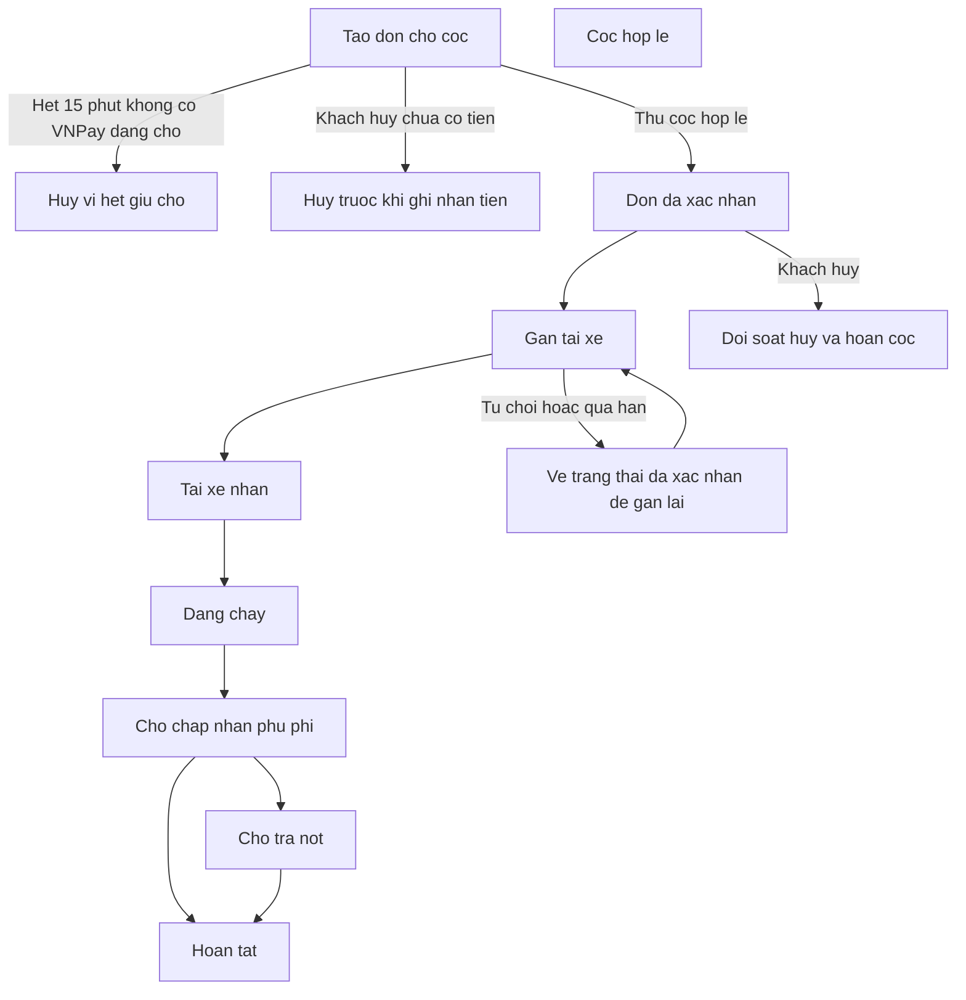
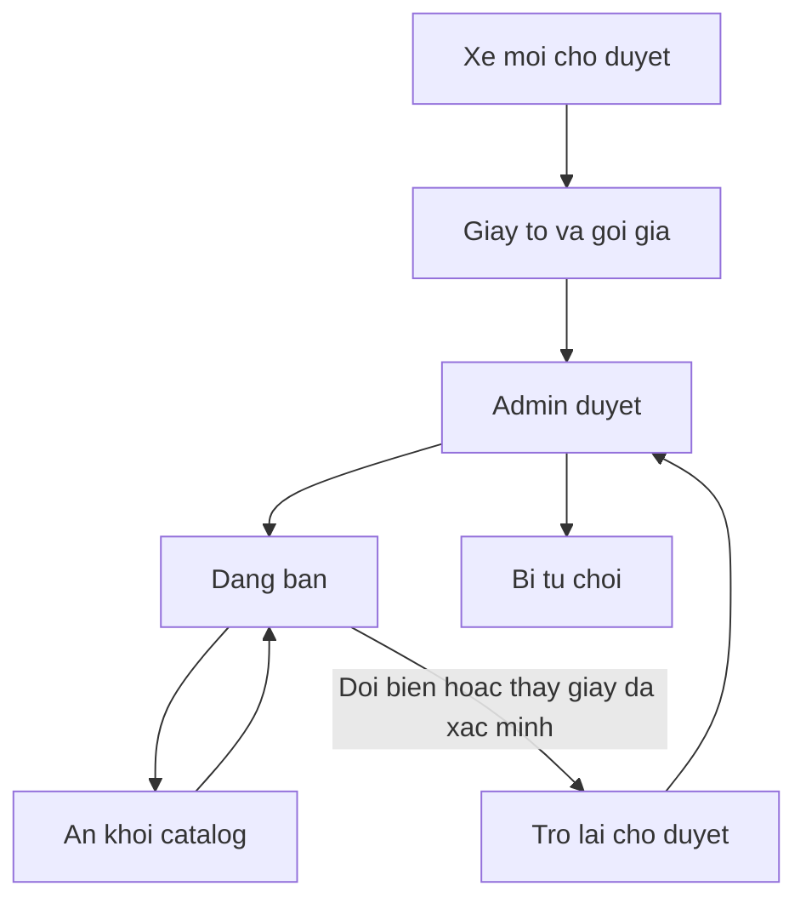

> Cập nhật chính sách thanh toán 08/11/2026: checkout dùng VietQR động/VNPay với số tiền backend tạo; không tự động hoàn phần dư. Ngoại lệ thực nhận theo sao kê đi qua đối soát thủ công. Chi tiết và giới hạn xác minh: [PAYMENT_POLICY_VI.md](PAYMENT_POLICY_VI.md).

# Luồng nghiệp vụ EcoMotion

Tài liệu này mô tả các luồng đang có trong code frontend và backend, kèm nhánh khi việc không đi đúng đường. Đọc như sổ tay vận hành, không phải spec môn học.

EcoMotion là nền tảng thuê xe theo khối thời gian. Khách chọn đúng một chiếc xe. Gói giờ, ngày và tháng đi kèm tài xế. Gói năm là tự lái: khách dùng GPLX của mình, không phân công tài xế nhà xe.

Một email chỉ có một vai trò: người thuê, nhà cung cấp, tài xế, hoặc admin. Muốn vừa thuê vừa cho thuê thì dùng hai tài khoản.

Tiền trên đơn đã tạo được tính từ bản chụp chính sách lúc đặt (`booking_policy_snapshot`), không đọc lại bảng giá hiện tại của xe.

Có hai kênh tiền:

- VietQR động chứa số tiền/nội dung backend tạo, chuyển vào tài khoản nhà xe. Provider chỉ xác nhận sau đối chiếu ghi có ngân hàng; QR và biên lai không chứng minh tiền thực nhận. Chưa có webhook ngân hàng VietQR.
- VNPay. Chỉ thông báo máy chủ (IPN) hoặc truy vấn cổng đã xác minh mới ghi nhận đã trả. Trang trình duyệt quay về chỉ để đọc kết quả, không tự chốt đơn.

Giao diện chạy ở `http://localhost:5173`. API ở `http://localhost:8080`. Tài khoản demo chỉ có khi backend chạy profile `dev` và seeder đã chạy.

---

## Tài khoản demo

Mật khẩu chung: `EcoMotion@123`.

| Vai trò | Email | Dùng để |
| --- | --- | --- |
| Người thuê | `renter01@ecomotion.vn` | Đặt xe, đơn seed `EM-2026-9001`, `EM-2026-9002`, `EM-2026-9003` |
| Người thuê | `renter.demo@ecomotion.vn` | Hồ sơ tên Phạm Thu Hà |
| Nhà xe A | `provider.a@ecomotion.vn` | Xe VF 6 `51A-11111` và ba tài xế |
| Nhà xe B | `provider.b@ecomotion.vn` | BMW, Porsche, Camry, Range Rover |
| Admin | `admin01@ecomotion.vn` | `/admin` |
| Tài xế | `driver.nam@ecomotion.vn` | Thuộc nhà xe A |
| Tài xế | `driver.cuong@ecomotion.vn` | Thuộc nhà xe A |
| Tài xế | `driver.kiet@ecomotion.vn` | Thuộc nhà xe A |
| Thuê năm đang chạy | `renter.yearly.monthly@ecomotion.vn` | Đơn EM-Y2-MONTHLY, thanh toán kỳ tiếp theo |
| Thuê năm kết thúc | `renter.yearly.happy-end@ecomotion.vn` | Đơn EM-Y2-HAPPY-END, kiểm định và hoàn cọc |
| Người mới thuê năm | `renter.yearly.new@ecomotion.vn` | Quét GPLX thật, đặt xe 51Y-00001 |
| Nhà xe chờ duyệt | `provider.pending@ecomotion.vn` | `ProviderStatus` chưa APPROVED |
| Người thuê eKYC chờ | `renter.pending@ecomotion.vn` | Tài khoản active, eKYC pending |
| Tài xế chờ duyệt | `driver.pending@ecomotion.vn` | `DriverStatus` PENDING |

Đơn seed gắn `renter01`:

- `EM-2026-9001`: đã được nhận, đang chờ cọc.
- `EM-2026-9002`: đang chờ nhà xe duyệt.
- `EM-2026-9003`: chuyến đang chạy.

Sau đăng nhập, hệ thống đưa về trang nhà theo vai trò: người thuê về `/`, nhà xe về `/provider`, tài xế về `/driver/schedule`, admin về `/admin`.

---

## 1. Đăng ký, đăng nhập, kích hoạt người thuê

Ai làm: khách chưa có tài khoản. Màn hình: `/register`, `/activate`, `/login`.

Trạng thái tài khoản: `PENDING` (mới tạo, chưa kích hoạt), `ACTIVE`, `LOCKED`.
Trạng thái eKYC: `UNVERIFIED`, `PENDING`, `VERIFIED`, `REJECTED`.

### Đường đúng

1. Nhập email, gửi OTP đăng ký. Email chưa tồn tại thì OTP được gửi.
2. Nhập đúng OTP. Hệ thống cấp token đăng ký (mặc định khoảng 30 phút).
3. Gửi form đăng ký kèm captcha. Chỉ vai trò người thuê được tạo qua form này. User mới ở `PENDING`, eKYC `UNVERIFIED`, và có hồ sơ renter.
4. Mở `/activate` bằng token kích hoạt (mặc định khoảng 60 phút).
5. Xác minh số điện thoại bằng OTP.
6. Quét CCCD. Hệ thống đọc giấy, lưu ảnh, eKYC chuyển `PENDING`.
7. Đối chiếu khuôn mặt. Khớp thì user thành `ACTIVE` và eKYC `VERIFIED`. Lúc này mới đăng nhập được.

### Khi thất bại

- Email đã có: không gửi OTP đăng ký, báo trùng.
- Gửi OTP thất bại: có thể thử lại. Gửi lại quá sớm thì bị chặn theo cooldown.
- OTP sai: được thử đến khi hết số lần (mặc định 5), rồi phải đợi. OTP hết hạn thì gửi mã mới.
- Token đăng ký hoặc kích hoạt hết hạn: làm lại bước OTP tương ứng. Có luồng “tiếp tục kích hoạt” nếu user vẫn `PENDING`.
- Chọn vai trò nhà cung cấp trên form đăng ký: giao diện tắt lựa chọn này. Backend cũng từ chối role khác người thuê.
- Captcha sai hoặc tắt cấu hình sai: đăng ký và đăng nhập bị từ chối.
- Số điện thoại đã thuộc user khác: không gán được.
- Chưa xác minh điện thoại mà nhảy tới khuôn mặt: bị chặn.
- Ảnh CCCD thiếu trường hoặc không đọc được: không lưu danh tính.
- CCCD đã dùng cho tài khoản khác: bị chặn.
- Khuôn mặt không khớp: API vẫn trả thành công với cờ không khớp. Tài khoản không được kích hoạt. Người dùng chụp lại.
- Đăng nhập khi còn `PENDING`: bị từ chối và giao diện đưa sang `/activate`.
- Đăng nhập khi `LOCKED`: bị từ chối, không vào được các trang cần đăng nhập.
- Token cũ của user không còn `ACTIVE`: các API bảo vệ coi như chưa đăng nhập.

Admin có thể đổi trạng thái user sang `ACTIVE`, `LOCKED` hoặc `PENDING` trong tab người dùng. Việc này khóa hoặc mở đăng nhập, tách với việc duyệt hồ sơ nhà xe hay tài xế.

---

## 2. Nhà cung cấp và tài xế vào hệ thống

### Nhà cung cấp

Web không có đăng ký nhà cung cấp cho khách tự làm. Tài khoản nhà xe được tạo bởi vận hành hoặc dữ liệu demo, rồi admin duyệt tổ chức.

Trạng thái tổ chức: `PENDING`, `APPROVED`, `LOCKED`.

Đường đúng: admin mở `/admin`, tab nhà cung cấp, chuyển `PENDING` sang `APPROVED`. Nếu user nhà xe còn `PENDING` thì lúc duyệt tổ chức, user cũng được đưa lên `ACTIVE`.

Khi thất bại hoặc chưa xong:

- Admin chọn `LOCKED`: tổ chức bị đánh dấu khóa. Trong code hiện tại, cờ này chủ yếu nằm trên hồ sơ. Các API quản lý xe chưa chặn hết mọi thao tác chỉ vì `LOCKED`.
- Nhà xe `PENDING` nhưng user đã `ACTIVE` vẫn đăng nhập được vào `/provider`. Xe của họ chỉ hiện cho khách khi từng chiếc đã được duyệt.

### Tài xế do nhà xe tạo

Màn hình: `/provider/drivers`.

Đường đúng:

1. Nhà xe tải ảnh và tạo tài xế. User tài xế được tạo sẵn `ACTIVE`. Mật khẩu ban đầu là mật khẩu nhà xe nhập, hoặc mặc định `EcoMotion@123`.
2. Hồ sơ tài xế ở `PENDING`.
3. Admin duyệt `APPROVED` hoặc `REJECTED` kèm lý do.
4. Sau khi `APPROVED`, nhà xe chỉ được chuyển qua lại `APPROVED` và `SUSPENDED`.

Khi thất bại:

- Tài xế `PENDING` hoặc `REJECTED` vẫn đăng nhập nếu user `ACTIVE`, nhưng API chuyến từ chối và trạng thái vận hành là offline. Không nhận cuốc.
- Nhà xe không tạm ngưng được tài xế đang `PENDING` hoặc `REJECTED`.
- Sửa GPLX hoặc dữ liệu nhạy cảm của tài xế đã duyệt: hồ sơ quay về `PENDING`, phải admin duyệt lại.
- Sửa tài xế đã `REJECTED`: hồ sơ về `PENDING` và xóa lý do từ chối cũ.
- Admin từ chối: lưu lý do, tài xế không được gán chuyến.

---

## 3. Đăng xe, giấy tờ, giá, lịch, và admin duyệt xe

Ai làm: nhà xe tại `/provider/vehicles`, admin tại `/admin` tab xe.

Trạng thái xe: `PENDING`, `APPROVED`, `REJECTED`, `HIDDEN`.
Giấy tờ: `PENDING`, `VERIFIED`, `REJECTED`. Loại giấy trên form: đăng ký, đăng kiểm, bảo hiểm, phù hiệu.
Gói giá: `HOURLY`, `DAILY`, `MONTHLY`, `YEARLY`, mỗi gói `ACTIVE` hoặc `INACTIVE`.

Khách chỉ thấy xe `APPROVED` và có ít nhất một gói đang `ACTIVE`.

### Đường đúng

1. Nhà xe tạo xe. Biển số, số khung, số máy phải đúng định dạng và chưa trùng. Xe mới là `PENDING`. Có thể gắn ảnh bìa.
2. Vào hub xe, tải bốn loại giấy. Giấy không phải đăng ký xe cần ngày hết hạn. Mỗi giấy lúc lưu là `PENDING`.
3. Khai bốn gói giá. Gói đang bật phải có giá lớn hơn 0. Gói năm dùng khoản trả trước, không dùng các trường phụ phí kiểu thuê giờ.
4. Có thể đặt tỷ lệ cọc riêng cho xe, và tài khoản nhận tiền ở `/provider/finance`.
5. Admin mở chi tiết xe và chọn duyệt. Xe thành `APPROVED`. Mọi giấy đang `PENDING` thành `VERIFIED`.
6. Xe đã duyệt có thể tắt hiện thị. Trạng thái thành `HIDDEN`, không còn trên catalog. Bật lại thì về `APPROVED`.

### Khi thất bại hoặc phải duyệt lại

- Trùng biển, số khung hoặc số máy: tạo hoặc sửa bị từ chối.
- Đổi biển số của xe đã có: xe về `PENDING` và có lịch sử đổi biển. Phải admin duyệt lại.
- Thay một giấy đã `VERIFIED`: giấy đó về `PENDING` và cả xe về `PENDING`.
- Admin từ chối: xe `REJECTED`, giấy đang `PENDING` thành `REJECTED`. Form admin có ô lý do, nhưng backend không lưu lý do đó lên xe.
- Bật hoặc tắt hiện thị khi xe còn `PENDING` hoặc `REJECTED`: giao diện báo xe chưa ở trạng thái được hiện.
- Gói bật mà giá bằng 0: không lưu. Đổi giá từ 50% trở lên mà chưa xác nhận biến động lớn: không lưu.
- Thiếu một trong bốn giấy: giao diện đếm đủ bộ, nhưng backend vẫn cho admin duyệt nếu họ bấm duyệt. Không có cổng bắt buộc đủ giấy.
- Trạng thái giấy `EXPIRED` có trong enum, chưa có job tự chuyển giấy hết hạn.

### Lịch chặn xe

Màn hình: `/provider/schedules`.

Nhà xe tạo khoảng `MAINTENANCE` hoặc `BLOCKED` ở trạng thái đang hiệu lực. Không tạo tay loại `BOOKED`. Không tạo khoảng trong quá khứ. Khoảng trùng đơn đang giữ hoặc đang thuê thì bị từ chối. Hủy lịch chặn đưa về `CANCELLED` và nhả xe. Lịch do đơn thuê chiếm thì phải xử lý trên đơn, không hủy từ màn lịch.

### Tài khoản nhận tiền

Nhà xe thêm tài khoản ngân hàng thuộc danh sách ngân hàng được hỗ trợ. Tài khoản mới đang dùng sẽ tắt các tài khoản active cũ. Chưa có bản ghi thì hệ thống còn đọc bản chụp trên hồ sơ nhà xe. Sai mã ngân hàng hoặc số tài khoản thì không lưu.

---

## 4. Người thuê tìm xe và xem giá

Màn hình: `/`, `/vehicles/:id`.

Đường đúng: khách lọc xe đã duyệt, mở chi tiết, chọn gói giờ, ngày hoặc tháng. Hệ thống ghép các slot thành một khoảng thuê, làm tròn theo giờ, và báo các cửa sổ còn trống. Phí đón tính từ điểm xuất phát của xe nếu xe có tọa độ xuất phát, không thì từ bãi nhà xe, so với điểm đón và bán kính miễn phí của gói.

Khi không đi tiếp được:

- Xe chưa duyệt, đang ẩn, hoặc không có gói active: không xuất hiện để đặt.
- Nhà xe chưa có tọa độ xuất phát và chưa có tọa độ bãi: không báo được phí đón.
- Gói chưa có bán kính hoặc đơn giá vượt bán kính hợp lệ: không báo phí đón.
- Chưa chọn tọa độ điểm đón: yêu cầu chọn lại.
- Khoảng thời gian trùng đơn khác của cùng người thuê: phương án đó bị loại. Nếu còn phương án khác thì khách chọn phương án còn lại.
- Gói năm không đi qua báo giá thuê có tài xế. Phải vào luồng hợp đồng năm.

---

## 5. Đặt xe có tài xế, đường chính

Áp dụng gói giờ, ngày, tháng. Màn hình người thuê: `/renter/bookings/new`, danh sách `/renter/bookings`, chi tiết `/renter/bookings/:bookingCode`, thanh toán `/renter/bookings/:bookingCode/payment`. Nhà xe: `/provider/bookings` và chi tiết đơn. Tài xế: `/driver/schedule` và `/driver/trips/:bookingCode`.

Trạng thái đi theo thứ tự vận hành:

`AWAITING_DEPOSIT` → `CONFIRMED` → `DRIVER_ASSIGNED` → `DRIVER_CONFIRMED` → `DRIVER_ARRIVED` → `AWAITING_START_CONFIRMATION` hoặc thẳng `IN_PROGRESS` → `AWAITING_EXTRA_CHARGE_CONFIRMATION` → `AWAITING_FINAL_PAYMENT` hoặc `COMPLETED`.

### Các bước

1. Người thuê gửi yêu cầu. Lúc tạo, hệ thống cần có tài xế có thể nhận trong khoảng đó. Đơn có tài xế mới vào thẳng `AWAITING_DEPOSIT`, giữ chỗ khoảng 15 phút, và có yêu cầu thanh toán cọc.
2. Người thuê trả cọc bằng chuyển khoản kèm biên lai, hoặc bằng VNPay.
3. Khi cọc được ghi nhận hợp lệ, đơn thành `CONFIRMED` và lịch xe được khóa. Nếu chế độ gán là tự động hoàn toàn, hệ thống có thể gán tài xế ngay sau khi thu cọc.
4. Nếu chưa tự gán, nhà xe gán tay hoặc nhận gợi ý rồi gán. Đơn thành `DRIVER_ASSIGNED`. Tài xế có hạn phản hồi.
5. Tài xế nhận chuyến: `DRIVER_CONFIRMED`. Đến điểm đón: `DRIVER_ARRIVED`.
6. Tài xế bấm bắt đầu và người thuê xác nhận bắt đầu. Khi cả hai đã xác nhận, đơn thành `IN_PROGRESS` và có giờ bắt đầu thực tế. Nếu mới một phía xác nhận, đơn ở `AWAITING_START_CONFIRMATION`.
7. Cuối chuyến, cả hai xác nhận kết thúc. Đơn sang `AWAITING_EXTRA_CHARGE_CONFIRMATION`.
8. Nhà xe thêm phụ phí nếu có. Mỗi khoản ở trạng thái chờ người thuê. Người thuê chấp nhận từng khoản.
9. Nhà xe chốt quyết toán. Nếu không còn tiền phải trả, đơn `COMPLETED`. Nếu còn, đơn `AWAITING_FINAL_PAYMENT`, người thuê trả nốt, rồi `COMPLETED`.
10. Sau `COMPLETED`, người thuê đánh giá xe, và đánh giá tài xế nếu đơn có tài xế. Màn hình: `/renter/bookings/:bookingCode/reviews`.

Người thuê chỉ sửa giờ đón, địa chỉ, số khách và ghi chú khi đơn còn hủy được và còn trong các bước sớm, chủ yếu khi đang chờ cọc.

---

## 6. Nhánh thất bại của đặt xe, cọc, huỷ và thanh toán

### Trước khi tiền cọc được ghi nhận

Người thuê hủy khi đơn còn `AWAITING_DEPOSIT` và chưa có khoản cọc đã thu:

- Số hoàn là 0.
- Nếu chưa gửi biên lai, yêu cầu cọc bị hủy (`VOIDED`) và đơn thành `CANCELLED`.
- Nếu đã gửi biên lai, hoặc yêu cầu đang trả một phần, hoặc đang chờ đối soát, mà tiền chưa được ghi nhận: đơn thành `CANCELLATION_REVIEW`, yêu cầu cọc thành `REVIEW_REQUIRED`. Nhà xe phải xem biên lai trước khi coi là xong.
- Hết 15 phút giữ chỗ, không có giao dịch VNPay còn `PENDING`, và không có biên lai cần giữ: yêu cầu cọc hết hạn, lịch được nhả, đơn `CANCELLED` với lý do `DEPOSIT_TIMEOUT`.
- Nếu VNPay còn `PENDING`, job hết hạn bỏ qua đơn đó và đợi đối soát cổng.
- Biên lai chuyển khoản gửi muộn có thể đưa yêu cầu sang `REVIEW_REQUIRED` và gia hạn giữ chỗ, tối đa đến mức hệ thống cho phép trước giờ đón.

Chưa có cọc thì không có chuyện hoàn 100% hay 50%.

### Sau khi đã thu cọc, người thuê hủy

Người thuê chỉ hủy được khi đơn còn một trong: `PENDING`, `ACCEPTED`, `AWAITING_DEPOSIT`, `CONFIRMED`.

Từ `DRIVER_ASSIGNED` trở đi, nút hủy của người thuê không còn. Muốn dừng phải đi hướng nhà xe xử lý vận hành, hoặc kết thúc chuyến theo luồng tài xế.

Khi đã có cọc ghi nhận trên sổ (`DEPOSIT_PAY`, tiền vào, trạng thái đã trả), số hoàn cọc phụ thuộc khoảng cách từ lúc hủy đến giờ đón:

| Gói | Hủy còn đủ sớm | Hủy sát giờ đón, hoặc hủy sau giờ đón |
| --- | --- | --- |
| Giờ hoặc ngày | Còn từ 24 giờ trở lên: hoàn 100% số cọc đã thu | Dưới 24 giờ: hoàn 50% cọc. Nửa còn lại ở lại phía nhà xe theo chính sách demo |
| Tháng | Còn từ 30 ngày trở lên: hoàn 100% cọc | Dưới 30 ngày: hoàn 50% cọc |
| Năm | Không dùng bảng này. Hoàn theo hủy của người thuê là 0 | Như cột bên |

Ví dụ cọc 300.000 đồng, gói ngày: hủy lúc còn 30 giờ trước giờ đón thì nghĩa vụ hoàn là 300.000. Hủy lúc còn 2 giờ thì nghĩa vụ hoàn là 150.000.

“Nghĩa vụ hoàn” chưa phải tiền đã về tài khoản. Hệ thống tạo yêu cầu hoàn `CANCEL:{mã đơn}`. Đơn vào `CANCELLATION_REVIEW` vì đã có tiền hoặc biên lai đang mở. Nhà xe duyệt và chuyển khoản ở mục hoàn tiền. Khi không còn nghĩa vụ hoàn hay khoản đang đối soát, đơn mới về `CANCELLED`.

Nếu hủy mà số hoàn tính ra bằng 0 và không còn biên lai mở, đơn có thể thành `CANCELLED` ngay.

Cọc đã `CONFIRMED` không bị xóa khi hủy. Nhà xe không được xác nhận thu cọc thêm lần nữa trên đơn đang hủy hoặc đã hủy. Họ chuyển sang hoàn tiền. Từ chối một khoản đã ghi nhận tiền cũng bị chặn, vì tiền đã vào thì phải hoàn, không được “từ chối biên lai” cho mất.

### Nhà xe từ chối đơn

`deny` áp dụng khi đơn còn `PENDING`. Kết quả là `REJECTED`. Luồng có tài xế hiện tạo thẳng `AWAITING_DEPOSIT`, nên từ chối này chủ yếu gặp ở thuê năm hoặc đơn seed còn chờ duyệt. Chưa thu tiền thì không phát sinh hoàn theo phần trăm.

### Thanh toán chuyển khoản

1. Người thuê mở checkout VietQR động hoặc VNPay; backend chốt số tiền và mã tham chiếu. Checkout chuẩn không yêu cầu nhập số tiền. Ảnh biên lai chỉ hỗ trợ tra soát.
2. Với VietQR, nhà xe tại `/provider/finance` đối chiếu sao kê tài khoản nhận rồi xác nhận đúng khoản thực nhận. Không bấm xác nhận chỉ dựa trên biên lai khách. VNPay dùng chữ ký/merchant/mã tham chiếu/số tiền và trạng thái từ IPN hoặc QueryDR đã xác thực; browser return không tự xác nhận.
3. Đúng và đủ nghĩa vụ, còn đủ điều kiện booking/hold thì xác nhận thanh toán. Xác nhận thủ công legacy cho khoản nhận một phần vẫn ghi đúng số thực nhận là `PARTIALLY_PAID`, không xác nhận booking khi chưa đủ. Đây là ngoại lệ do provider đối chiếu, không phải checkout yêu cầu khách tự nhập tiền.
4. Chuyển sai số tiền hoặc tiền đến muộn đã được xác minh: dùng **Tiền nhận cần đối soát** (`POST /api/provider/payment-requests/{id}/bank-reconciliation`). Lưu đầy đủ tiền thực nhận, mã ngân hàng, thời điểm ghi có, tham chiếu sao kê, người xác minh và audit; `appliedAmount = 0`, `REVIEW_REQUIRED`, không tự xác nhận booking hoặc tạo refund phần dư. Xử lý hoàn, nếu có quyết định, qua quy trình hoàn thủ công hiện có.

Không đi tiếp được khi:

- Đơn đang hủy, hoặc khoản đã thu đủ: không xác nhận thêm. Thông báo xử lý hoàn.
- Yêu cầu đã từ chối hoặc đã void: không xác nhận.
- Đã có giao dịch cần đối soát gắn với yêu cầu này: không xác nhận thu tiếp như một lần thành công mới.
- Thao tác đối soát ngoại lệ mới bắt buộc mã ngân hàng, tham chiếu sao kê, thời điểm thực nhận và xác nhận đã kiểm tra sao kê. API confirm legacy còn hỗ trợ metadata tùy chọn; đây không phải cơ chế xác minh ngân hàng tự động.
- Mã ngân hàng đã dùng: không nhận lần hai.
- Cùng số tiền, cùng ghi chú, không có mã ngân hàng, đã ghi một lần: bị coi là gửi lại, cần mã ngân hàng để tách khoản mới.
- Số tiền, trạng thái đơn, giữ chỗ, tranh chấp hoặc hợp đồng năm không còn hợp lệ: tiền vẫn có thể được lưu là đã nhận nhưng số áp vào đơn bằng 0, ghi chú bắt đầu bằng `RECONCILIATION_REQUIRED`. Yêu cầu thành `REVIEW_REQUIRED`. Với khoản cọc hoặc trả trước, đơn thường sang `CANCELLATION_REVIEW` và lịch được nhả. Không coi là đặt cọc thành công. Sau đó hoàn hoặc đối soát bằng yêu cầu hoàn, thường là sự kiện tiền đến muộn.

### Thanh toán VNPay

1. Người thuê tạo giao dịch. Trên đơn, trạng thái thanh toán có thể hiện là đang xác minh khi còn giao dịch VNPay `PENDING`.
2. Trình duyệt trở về `/payment/vnpay/return` hoặc `/payment/vnpay/callback`. Trang này chỉ kiểm tra chữ ký và đọc trạng thái đã lưu.
3. IPN từ VNPay, hoặc API query khi giao dịch còn chờ và cổng trả lời đã xác minh, mới áp tiền vào đơn.
4. Áp thành công thì giống chuyển khoản hợp lệ: đơn `CONFIRMED` nếu là cọc hoặc trả trước.
5. Áp không được vì giữ chỗ hết, lịch đã bị đơn khác lấy, giấy tờ năm không còn đủ, hoặc số tiền quyết toán không khớp: ghi `RECONCILIATION_REQUIRED`, số áp dụng bằng 0, và giữ một yêu cầu hoàn `LATE_IPN:{mã giao dịch}`.

Giao dịch VNPay thất bại được đánh `FAILED`. Giao dịch `PENDING` quá hạn vẫn có thể chặn tạo giao dịch mới cho đến khi đối soát xong, để tránh thu hai lần.

Biên lai “tôi đã trả VNPay” do nhà xe tải lên không được dùng cho khoản hoàn qua VNPay. Hoàn VNPay đi theo cổng, không theo ảnh chuyển khoản.

### Không còn tài xế

- Lúc tạo đơn có tài xế mà không có tài xế rảnh và đủ GPLX đến hết ngày thuê: đơn không được tạo.
- Tài xế từ chối trong hạn, hoặc hết hạn không phản hồi: hệ thống gỡ tài xế đó, không chọn lại người đã từ chối hoặc quá hạn trên cùng đơn, tăng số lần đổi, đưa đơn về `CONFIRMED`, rồi thử gán người khác.
- Hết số lần đổi tự động, hoặc không còn ứng viên: đơn ở `CONFIRMED` và báo không còn tài xế. Nhà xe phải gán tay một người hợp lệ.
- Tài xế đã nhận nhưng báo không chạy được trước giờ chạy: nhà xe gán người thay.
- GPLX tài xế không còn hạn đến ngày cuối của khoảng thuê: người đó không nằm trong danh sách gán được.

Nhãn lý do hủy `PROVIDER_NO_DRIVER` và `PROVIDER_NO_VEHICLE` có trong enum và chữ trên giao diện. Đường hủy vì nhà xe không phục vụ được trong code hiện ghi lý do `PREVIOUS_RENTER_OVERDUE` khi chọn “hủy và hoàn”, chứ không tự gán hai nhãn kia.

---

## 7. Đổi xe hoặc dời giờ

Chỉ khi đơn còn `AWAITING_DEPOSIT`, `CONFIRMED`, `DRIVER_ASSIGNED` hoặc `DRIVER_CONFIRMED`. Sau khi chuyến đã bắt đầu thì không đổi bằng luồng này.

Đường đúng khi cần khách đồng ý:

1. Nhà xe gửi một đề xuất gần nhất: đổi xe hoặc dời giờ. Đề xuất có mã để tab cũ không bấm nhầm.
2. Đúng người thuê của đơn chọn chấp nhận. Hệ thống khóa và kiểm tra lại lịch xe, xe, và tài xế.
3. Chấp nhận thì áp dụng. Đổi xe thì chuyển lịch sang xe mới. Dời giờ thì đổi giờ đón và giờ trả dự kiến theo cùng thời lượng. Giá và snapshot chính sách không đổi. Yêu cầu tài xế được làm mới. Giao diện gửi lại mốc thời điểm đã gán để không xác nhận nhầm điều khoản cũ.
4. Người thuê từ chối, hoặc nhà xe rút đề xuất: đơn giữ xe và giờ cũ.

Nhà xe cũng có thể chọn hủy và hoàn mà không chờ khách đồng ý phương án khác. Khi đó hệ thống hoàn 100% số tiền đã nhận còn có thể hoàn, sự kiện `PROVIDER_CANCEL:{mã đơn}`. Có tiền thì đơn vào `CANCELLATION_REVIEW`. Không còn tiền thì `CANCELLED`. Đây là hoàn toàn bộ tiền đã thu, không dùng mốc 24 giờ hay 30 ngày.

---

## 8. Thuê năm, tự lái

Màn hình: `/renter/yearly-rental` và `/renter/bookings/:bookingCode/yearly-rental`. GPLX cũng xem được ở `/me`.

Điều kiện demo: nhóm B (B, B1, B2), không giới hạn ngày cấp từ 2025, còn hạn đến hết ngày kết thúc kỳ 12 tháng theo lịch, người thuê đủ 18 tuổi vào ngày nhận xe, xe không quá số chỗ chính sách đang cho phép. Đây là kiểm tra trong đồ án, không phải xác thực với cơ quan nhà nước.

### Đường đúng

1. Người thuê tải ảnh mặt trước và mặt sau GPLX. Dịch vụ DocumentAI đọc giấy. Đọc đạt thì `licenseVerified` bật và điền số, họ tên, hạng, ngày cấp, ngày hết hạn. Ảnh chỉ người đã đăng nhập đúng tài khoản xem được.
2. Chọn một gói năm đang bật, đúng một kỳ 12 tháng theo lịch. Giờ nhận xe phải cách lúc gửi ít nhất 3 giờ. Chọn điểm nhận và số khách không vượt chỗ còn lại sau chỗ lái.
3. Gửi đơn: trạng thái `PENDING`, giữ chỗ 24 giờ. Chưa có yêu cầu thanh toán, chưa có tài xế.
4. Nhà xe chấp nhận trong 24 giờ: đơn `ACCEPTED`, mở một cửa sổ 24 giờ để nộp hợp đồng.
5. Người thuê tải PDF hợp đồng đã ký. Hệ thống kiểm tra lại GPLX. Hợp lệ thì đơn sang `AWAITING_DEPOSIT` và tạo yêu cầu trả trước.
6. Trả trước thành công, giao dịch loại `UPFRONT_PAY`. Đơn `CONFIRMED`, lịch xe được chốt.
7. Với đơn demo đang chạy, người thuê trả từng kỳ tháng (`MONTHLY_INSTALLMENT`) bằng VNPay hoặc chuyển khoản. Trả một kỳ không đổi trạng thái `IN_PROGRESS` của đơn seed.

### Khi thất bại

- Thiếu một mặt ảnh, sai định dạng, quá dung lượng, OCR không đọc được, hoặc OCR không khớp QR: không đánh dấu GPLX đủ điều kiện. DocumentAI tắt hoặc thiếu cấu hình: báo dịch vụ không dùng được.
- Số GPLX trùng tài khoản khác: không lưu.
- Tự sửa số, hạng hoặc hạn sau khi đã xác minh bằng ảnh: cờ đã xác minh tắt và ảnh AI bị xóa. Phải đọc lại hoặc không đủ điều kiện đặt năm.
- Hạng không hỗ trợ, hết hạn trước ngày trả, dưới 18 tuổi, hoặc xe vượt chính sách chỗ: cả giao diện và backend chặn.
- Nhà xe không phản hồi trong 24 giờ lúc `PENDING`: đơn `CANCELLED`, lý do `YEARLY_REQUEST_TIMEOUT`, nhả lịch.
- Đã được nhận mà không nộp hợp đồng trước khi hết giữ chỗ: `CANCELLED`, lý do `YEARLY_CONTRACT_TIMEOUT`.
- Tải hợp đồng khi GPLX không còn đủ, hoặc cố thanh toán trước khi có hợp đồng: bị từ chối.
- Người thuê hủy đơn năm khi còn trong nhóm được hủy: số hoàn trả trước là 0. Nếu đã có tiền hoặc biên lai đang mở, đơn vẫn có thể vào `CANCELLATION_REVIEW` để đối soát, nhưng công thức phần trăm cọc không áp dụng.
- Chưa có job tự đưa đơn năm từ `CONFIRMED` sang `IN_PROGRESS` đúng giờ nhận xe. Đơn seed đang chạy được ghi thẳng `IN_PROGRESS`. Đừng hiểu màn kỳ tháng là lịch tự thu đủ 12 tháng. Seeder hiện tạo một kỳ để demo.

---

## 9. Tài xế trên chuyến

Ai làm: tài xế đã `APPROVED`, user `ACTIVE`. Màn hình lịch và chi tiết chuyến.

Đường đúng:

1. Thấy chuyến `DRIVER_ASSIGNED` còn trong hạn. Bấm nhận. Đơn `DRIVER_CONFIRMED`.
2. Đến điểm đón. Đơn `DRIVER_ARRIVED`.
3. Bấm bắt đầu. Nếu người thuê chưa xác nhận, đơn chờ đủ hai phía. Khi đủ, `IN_PROGRESS`.
4. Bấm kết thúc. Người thuê cũng xác nhận kết thúc. Đơn sang chờ chốt phụ phí.
5. Có thể gửi vị trí trong lúc chạy. Nhà xe xem trên chi tiết đơn.

Khi thất bại:

- Hết hạn không nhận: hệ thống đánh quá hạn và tìm tài xế khác, như mục không còn tài xế.
- Từ chối trong hạn: cùng cơ chế, và người này không được hệ thống chọn lại cho đơn đó.
- Bấm sai bước, ví dụ kết thúc khi chưa bắt đầu: máy trạng thái chuyến từ chối.
- Đơn đã hủy, đã từ chối, hoặc đã hoàn thành: không thao tác chuyến nữa.
- Tài xế chưa được admin duyệt: API chuyến trả lỗi quyền, dù đăng nhập được.

Nhà xe thêm phụ phí tay trong lúc hoặc sau chuyến có tài xế: số lượng, lý do, ảnh. Đơn giá và tỷ lệ lấy từ snapshot, không lấy giá gói đang sửa trên xe. Gói năm không thêm phụ phí cuối chuyến theo luồng này.

---

## 10. Hoàn tiền

Hoàn tiền là một hồ sơ riêng, không biến mất khỏi ví ngay khi bấm hủy.

Các lần hệ thống tự tạo nghĩa vụ hoàn:

| Việc vừa xảy ra | Mã sự kiện | Số tiền |
| --- | --- | --- |
| Người thuê hủy sau khi đã thu cọc | `CANCEL:{đơn}` | 100% hoặc 50% cọc theo mục 6, năm thì 0 |
| Nhà xe hủy vì không phục vụ được | `PROVIDER_CANCEL:{đơn}` | 100% số đã nhận còn hoàn được |
| Tiền đến nhưng không áp được vào đơn | `LATE_IPN:{mã}` | Khoản không áp dụng được |
| Chuyển sai số tiền đã nhận | `BANK_RECEIPT` audit + `REVIEW_REQUIRED` | Ghi đủ thực nhận, chưa phân bổ; không tự tạo hoàn. Quyết định hoàn thủ công dùng sự kiện `MANUAL:{...}` hiện có |
| Chốt chuyến mà đã thu nhiều hơn nghĩa vụ | `SETTLE:{đơn}` | Phần thừa |
| Admin miễn một phụ phí đã thu | `WAIVE:{khoản phí}` | Phần mở sau khi miễn |

Đường chuyển tiền của nhà xe:

1. Yêu cầu ở chờ duyệt hoặc đang xem xét.
2. Nhà xe hoặc admin bấm duyệt. Sinh giao dịch hoàn chiều ra, trạng thái chờ, yêu cầu sang đang xử lý.
3. Nếu khoản không qua VNPay, nhà xe tải biên lai, nhập mã giao dịch ngân hàng, bấm xác nhận đã hoàn. Lúc đó mới tính là đã hoàn.
4. Khoản VNPay không nhận biên lai chuyển khoản ở bước này.
5. Từ chối yêu cầu hoàn thì phải có lý do. Tiền không được đánh dấu đã trả lại.

Không cho hoàn quá tổng tiền đã nhận. Mã chuyển khoản hoàn không được trùng. Còn yêu cầu hoàn đang mở, hoặc còn dòng tiền cần đối soát, thì đơn `CANCELLATION_REVIEW` chưa được đóng thành `CANCELLED`.

Người thuê hoặc admin cũng có thể tạo yêu cầu hoàn tay nếu còn số tiền hợp lệ, kèm số tiền và lý do. Yêu cầu mới vẫn bị trần bởi số đã thu trừ các khoản đã giữ chỗ hoàn.

Admin còn một nút hoàn mô phỏng trên tab vận hành. Nút đó ghi một giao dịch hoàn đã trả với mã giả, tách khỏi hồ sơ hoàn có duyệt và biên lai. Khi demo đối soát thật, dùng tab hoàn của nhà xe, không dùng nút mô phỏng.

---

## 11. Tranh chấp

Người thuê mở tranh chấp trên đơn của mình. Ảnh bằng chứng tải lên kho riêng của đơn.

| Loại | Khi nào mở được | Việc hệ thống làm |
| --- | --- | --- |
| Phụ phí | Đơn đang chờ chốt phụ phí hoặc chờ trả nốt | Khoản phí thành đang tranh chấp. Nếu yêu cầu trả nốt chưa thu, yêu cầu đó bị giữ ở chờ đối soát |
| Hoàn cọc | Đơn đã `CANCELLED` và có khoản cọc | Ghi hồ sơ để admin xem. Không tính lại phần trăm 24 giờ hoặc 30 ngày. Phần trăm đã chốt lúc bấm hủy |
| Chất lượng dịch vụ | Đơn đang chạy hoặc đã xong | Ghi hồ sơ, không tự hoàn tiền |
| Lệch xác nhận chuyến | Đơn đang chạy và chỉ một trong hai bên đã xác nhận mốc kết thúc đang xét | Ghi hồ sơ |

Không mở được khi: tranh chấp cùng loại còn mở, phụ phí đã được miễn, tranh chấp tiền thuê gốc hoặc chính khoản cọc như một “phụ phí”, hoặc đã xác nhận thanh toán quyết toán xong rồi mới đòi tranh chấp khoản đó.

Khi còn tranh chấp mở hoặc đang xem xét, nhà xe không chốt quyết toán và một số bước thu quyết toán bị chặn.

Admin xử lý ở `/admin`, tab vận hành.

Với tranh chấp phụ phí, admin phải chọn một:

- Miễn phí: khoản được đánh miễn và chấp nhận. Nếu khách đã trả nhiều hơn nghĩa vụ mới, hệ thống tạo hoàn `WAIVE`. Yêu cầu trả nốt được tính lại. Hết nợ thì đơn `COMPLETED`, còn nợ thì về chờ trả nốt với số mới.
- Giữ phí: khoản được chấp nhận. Yêu cầu trả nốt được làm lại theo số còn thiếu.

Tranh chấp đã giải quyết hoặc đã bác thì không xử lý lần nữa.

---

## 12. Việc còn lại của admin

Màn hình duy nhất: `/admin`.

- Tổng quan: số xe, user, hàng chờ duyệt nhà xe, tài xế, eKYC, xe, tranh chấp, và số liệu tháng khi chọn năm và tháng.
- Người dùng hệ thống: khóa hoặc mở `ACTIVE` / `LOCKED` / `PENDING`.
- eKYC: hàng chờ mặc định là `PENDING`. Admin đặt `VERIFIED` hoặc `REJECTED`. Thao tác này đổi cờ eKYC, không tự đổi trạng thái đăng nhập. Luồng tự kích hoạt bằng CCCD và khuôn mặt mới là đường đưa user mới lên `ACTIVE`.
- Đơn thuê: admin xem danh sách và chi tiết, gồm các khoản phí. Không thay người thuê bấm nhận chuyến.
- Thanh toán: xem giao dịch. Hoàn mô phỏng như mục 10.
- Chi hộ sandbox: chỉ admin, chỉ môi trường dev hoặc test khi bật cờ. Đơn phải hoàn thành, không còn tranh chấp mở, không còn hoàn đang mở, tiền VNPay đã đối soát, và nhà xe có tài khoản nhận đang active. Không giả lập ngân hàng đã trả tiền thật.

---

## 13. Đánh giá

Chỉ khi đơn `COMPLETED`. Người thuê gửi đánh giá cho xe. Nếu đơn có tài xế thì đánh giá tài xế trên cùng màn. Đơn chưa hoàn thành thì API từ chối. Mỗi phía chỉ đánh giá theo quy tắc một lần mà service đang chặn nếu đã có bản ghi.

---

## Sơ đồ vòng đời đơn có tài xế

Hủy sau khi đã thu cọc không nhảy thẳng sang “đã hủy” nếu còn tiền phải hoàn. Nhánh đó dừng ở đối soát cho đến khi nhà xe hoàn xong.

## Sơ đồ vòng đời xe

---

## Những chỗ code chưa làm hết

Đọc các mục trên theo đúng hành vi hiện tại. Các điểm sau dễ bị hiểu nhầm nếu chỉ nhìn tên enum:

- Nhà cung cấp không tự đăng ký trên `/register`.
- Lý do admin gõ khi từ chối xe không được lưu.
- Backend không bắt buộc đủ bốn giấy trước khi bấm duyệt xe.
- Giấy tờ không tự chuyển sang hết hạn.
- Khóa tổ chức nhà xe chưa chặn toàn bộ API quản lý xe.
- `PROVIDER_NO_DRIVER` và `PROVIDER_NO_VEHICLE` chưa được gán trên các đường hủy chính. Hủy do nhà xe không phục vụ được đang ghi `PREVIOUS_RENTER_OVERDUE`.
- Đơn năm không tự sang “đang chạy” khi đến giờ nhận. Kỳ tháng demo không tự sinh đủ 12 yêu cầu.
- Nút hoàn tiền mô phỏng của admin không phải hồ sơ hoàn có biên lai.
- `licenseVerified` chỉ nghĩa là lần đọc ảnh và QR đạt rule demo, không phải GPLX đã được cơ quan nhà nước xác thực.
- Máy trạng thái chuyến không liệt kê mọi trạng thái mà service thanh toán gán thẳng, ví dụ `CANCELLATION_REVIEW` khi đối soát. Khi hai bên lệch nhau, tin luồng service của từng việc hơn là chỉ nhìn bảng chuyển trạng thái của chuyến.

Các file quyết định hành vi nếu cần đối chiếu: `DepositRefundRules`, `BookingServiceImpl`, `BookingHoldExpiryServiceImpl`, `PaymentRequestServiceImpl`, `VnpayServiceImpl`, `RefundEventService`, `ProviderBookingServiceImpl`, `DriverOptimizationServiceImpl`, `DisputeServiceImpl`, `VehicleServiceImpl`, `ProviderVehicleServiceImpl`.

Gói năm có tài khoản riêng cho từng nhánh, được tạo cùng một lần seed; danh sách email, mã đơn và trình tự: [hướng dẫn demo năm](YEARLY_RENTAL_DEMO_TEST_GUIDE_VI.md).
