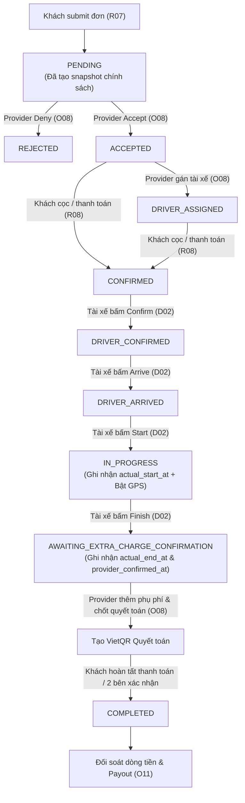

# TÀI LIỆU CHI TIẾT CHỨC NĂNG THÀNH VIÊN 5 (TV5) — ECOMOTION

> **Dự án:** EcoMotion — Nền tảng cho thuê xe kèm tài xế (Chauffeur-hire) theo gói thời gian  
> **Thành viên phụ trách:** TV5  
> **Phạm vi nghiệp vụ:** **Provider Bookings (O07, O08)** · **Provider Finance (O11)** · **Driver Schedule & Trip Execution (D01, D02)**  
> **Công nghệ áp dụng:**  
> - **Backend:** Spring Boot (Java 21), Spring Data JPA, Hibernate, Spring Security + JWT, PostgreSQL / H2  
> - **Frontend:** React 19, Vite, Tailwind CSS v4, Axios, React Router v7  

---

## MỤC LỤC
1. [Tổng quan 5 màn hình TV5 phụ trách](#1-tổng-quan-5-màn-hình-tv5-phụ-trách)
2. [Luồng trạng thái và vòng đời đơn hàng (State Machine)](#2-luồng-trạng-thái-và-vòng-đời-đơn-hàng-state-machine)
3. [Chi tiết Backend: Class nào dùng hàm nào](#3-chi-tiết-backend-class-nào-dùng-hàm-nào)
   - [3.1. Nhóm Provider Booking (O07, O08)](#31-nhóm-provider-booking-o07-o08)
   - [3.2. Nhóm Driver Schedule & Trip Execution (D01, D02)](#32-nhóm-driver-schedule--trip-execution-d01-d02)
   - [3.3. Nhóm Provider Finance (O11)](#33-nhóm-provider-finance-o11)
   - [3.4. Hệ thống Repository & Entity tham gia](#34-hệ-thống-repository--entity-tham-gia)
4. [Chi tiết Frontend: Cấu trúc, Giao diện & Luồng gọi API](#4-chi-tiết-frontend-cấu-trúc-giao-diện--luồng-gọi-api)
   - [4.1. Định tuyến (Routing & Protection)](#41-định-tuyến-routing--protection)
   - [4.2. Chi tiết từng trang Frontend (Pages)](#42-chi-tiết-từng-trang-frontend-pages)
   - [4.3. Các Modal tương tác (Provider Modals)](#43-các-modal-tương-tác-provider-modals)
   - [4.4. Hệ thống Custom Hooks](#44-hệ-thống-custom-hooks)
   - [4.5. Lớp Services kết nối API (Frontend API Client)](#45-lớp-services-kết-nối-api-frontend-api-client)
5. [Bảng tổng hợp đối chiếu API - Backend - Frontend](#5-bảng-tổng-hợp-đối-chiếu-api---backend---frontend)

---

## 1. TỔNG QUAN 5 MÀN HÌNH TV5 PHỤ TRÁCH

Theo phân công đồ án SBA301 (`docs/PHAN_CONG_6_THANH_VIEN.md` và `TV5_IMPLEMENTATION_GUIDE.txt`), TV5 chịu trách nhiệm toàn bộ luồng vận hành của **Nhà cung cấp (Provider)** và **Tài xế (Driver)** sau khi khách đặt xe:

| Mã màn | Tên màn hình | Actor | Vai trò chức năng chính |
| :--- | :--- | :--- | :--- |
| **O07** | **Provider Bookings** | `PROVIDER` | Hàng đợi danh sách đơn thuê xe, thống kê số lượng đơn theo trạng thái, bộ lọc trạng thái, xuất danh sách ra CSV. |
| **O08** | **Booking Detail** | `PROVIDER` | Xem chi tiết đơn đặt xe, duyệt đơn (**Accept**), từ chối đơn (**Deny**), **gán tài xế (Assign Driver)**, tạo phụ phí phát sinh thủ công (**Manual Surcharge**), theo dõi định vị xe trực tiếp (**Live Tracking**), chốt quyết toán đơn (**Finalize Settlement**). |
| **O11** | **Provider Finance** | `PROVIDER` | Cấu hình tài khoản ngân hàng nhận tiền thụ hưởng (**Bank Account**), xem tổng quan doanh thu/số dư, bảng đối soát giao dịch (**Financial Ledger / Transactions**), xem bóc tách tài chính đơn, đối soát hoa hồng sàn (**Platform Commission**), danh sách Payout (mock). |
| **D01** | **Driver Schedule** | `DRIVER` | Lịch trình chuyến xe được phân công cho tài xế: tab **Hôm nay (TODAY)**, **Sắp tới (UPCOMING)**, **Lịch sử (HISTORY)**, bộ lọc theo ngày & trạng thái, ghim chuyến đang chạy (**Active Trip Banner**). |
| **D02** | **Driver Trip Detail** | `DRIVER` | Chi tiết chuyến xe: xác nhận nhận chuyến (**Confirm**), báo đã tới điểm đón (**Arrive**), bắt đầu chuyến (**Start**), kết thúc chuyến (**Finish**), gửi tọa độ định vị GPS thiết bị theo thời gian thực (**Live GPS Location Tracking**). |

---

## 2. LUỒNG TRẠNG THÁI VÀ VÒNG ĐỜI ĐƠN HÀNG (STATE MACHINE)



---

## 3. CHI TIẾT BACKEND: CLASS NÀO DÙNG HÀM NÀO

### 3.1. Nhóm Provider Booking (O07, O08)

#### 1. Controller: `ProviderBookingController`
*Đường dẫn:* `com.fptufa26.ecomotion.booking.controller.ProviderBookingController`  
*Base URL:* `/api/provider/bookings` hoặc `/api/v1/provider/bookings`

| HTTP Method & Endpoint | Tên hàm Controller | Input Parameters | Vai trò & Nghiệp vụ |
| :--- | :--- | :--- | :--- |
| `GET /api/provider/bookings` | `listBookings` | `@AuthenticationPrincipal SecurityUser principal`, `@RequestParam(required = false) String status` | Lấy toàn bộ danh sách đơn đặt xe của Provider hiện tại theo trạng thái. |
| `GET /api/provider/bookings/paged` | `listBookingsPaged` | `principal`, `@RequestParam status`, `@RequestParam(defaultValue="0") int offset`, `@RequestParam(defaultValue="10") int limit` | Lấy danh sách đơn phân trang (`PageResponse`) phục vụ UI hiển thị mượt mà. |
| `GET /api/provider/bookings/summary` | `getSummary` | `principal` | Đếm số lượng đơn theo từng trạng thái (`PENDING`, `ACCEPTED`, `CONFIRMED`, `IN_PROGRESS`, `COMPLETED`, `CANCELLED`). |
| `GET /api/provider/bookings/{id}` | `getBookingDetail` | `principal`, `@PathVariable("id") String id` | Lấy chi tiết đơn xe theo mã đơn `bookingCode` hoặc `id` (thông tin xe, khách, tài xế, bảng phí, lịch trình). |
| `POST /api/provider/bookings/{id}/accept` | `acceptBooking` | `principal`, `@PathVariable("id") String id` | Chấp nhận đơn đặt xe đang ở trạng thái `PENDING` -> chuyển thành `ACCEPTED`. |
| `POST /api/provider/bookings/{id}/deny` | `denyBooking` | `principal`, `@PathVariable("id") String id`, `@RequestBody @Valid DenyBookingRequest request` | Từ chối đơn đặt xe -> chuyển thành `REJECTED`, ghi nhận lý do từ chối. |
| `PUT /api/provider/bookings/{id}/driver` | `assignDriver` | `principal`, `@PathVariable("id") String id`, `@RequestBody @Valid AssignDriverRequest request` | Gán tài xế cho đơn (`driverId`), kiểm tra tài xế thuộc cùng Provider và không trùng lịch. |
| `GET /api/provider/bookings/{id}/charges` | `getCharges` | `principal`, `@PathVariable("id") String id` | Lấy danh sách các khoản phí (tiền thuê xe, cọc, các phụ phí thủ công). |
| `POST /api/provider/bookings/{id}/charges` | `addCharge` | `principal`, `@PathVariable("id") String id`, `@RequestBody @Valid AddChargeRequest request` | Tạo phụ phí phát sinh thủ công (chờ đợi, quá giờ, vệ sinh, phí cầu đường...). |
| `POST /api/provider/bookings/{id}/settlement/finalize` | `finalizeSettlement` | `principal`, `@PathVariable("id") String id` | Khóa các khoản phụ phí, tạo yêu cầu thanh toán quyết toán VietQR gửi cho khách thuê. |
| `GET /api/provider/bookings/{id}/tracking` | `getTripTracking` | `principal`, `@PathVariable("id") String id` | Lấy dữ liệu giám sát hành trình (tọa độ hiện tại, trạng thái di chuyển, tốc độ). |
| `GET /api/provider/bookings/{id}/location` | `getTripLocation` | `principal`, `@PathVariable("id") String id` | Lấy tọa độ GPS mới nhất của xe phục vụ render icon xe trên bản đồ. |
| `GET /api/provider/bookings/export` | `exportBookings` | `principal`, `@RequestParam status` | Xuất file danh sách đơn hàng ra định dạng CSV (`text/csv`). |

#### 2. Service Interface: `ProviderBookingService`
*Đường dẫn:* `com.fptufa26.ecomotion.booking.service.ProviderBookingService`

#### 3. Service Implementation: `ProviderBookingServiceImpl`
*Đường dẫn:* `com.fptufa26.ecomotion.booking.service.implement.ProviderBookingServiceImpl`

| Tên hàm Service | Hàm / Repository phụ thuộc được gọi | Logic xử lý nghiệp vụ chi tiết |
| :--- | :--- | :--- |
| `listBookings(currentUserId, status)` | `userService.getByUserId(currentUserId)`<br/>`BookingSpecification.forProviderQueue(...)`<br/>`bookingRepository.findAll(spec, DEFAULT_SORT)` | Xác thực Provider từ JWT; lọc đơn xe thuộc sở hữu của Provider; mapping sang `ProviderBookingResponse`. |
| `listBookingsPaged(currentUserId, status, offset, limit)` | `bookingRepository.findAll(spec, pageable)`<br/>`vehicleService.getVehicleById(...)` | Tính toán offset/limit thành Spring Data `PageRequest`; nạp thêm ảnh đại diện cover URL của xe. |
| `getSummary(currentUserId)` | `bookingRepository.findAll(spec)` hoặc query count theo từng status | Gom nhóm và đếm số lượng đơn theo các trạng thái phục vụ hiển thị các thẻ thống kê đầu trang. |
| `getBookingDetail(currentUserId, bookingCodeOrId)` | `bookingRepository.findDetailByBookingCodeAndProviderId(...)`<br/>`bookingChargeRepository.findByBooking_IdOrderByCreatedAtAsc(...)` | Lấy đầy đủ thông tin entity: Renter, Vehicle, Driver, BookingCharge, PolicySnapshot; kiểm tra quyền sở hữu của Provider (tránh Provider khác xem trộm). |
| `acceptBooking(currentUserId, bookingCodeOrId)` | `bookingRepository.findByBookingCodeAndProviderIdForUpdate(...)`<br/>`scheduleService.isVehicleAvailable(...)` | Kiểm tra đơn phải đang ở trạng thái `PENDING`. Kiểm tra xe chưa bị trùng lịch trong khung giờ đó; cập nhật `status = ACCEPTED`. Không tạo snapshot mới (giữ nguyên snapshot từ R07). |
| `denyBooking(currentUserId, bookingCodeOrId, reason)` | `bookingRepository.save(booking)` | Kiểm tra đơn đang ở `PENDING`; cập nhật `status = REJECTED`, lưu `rejectionReason`. |
| `assignDriver(currentUserId, bookingCodeOrId, driverId)` | `driverRepository.findByIdAndProvider_Id(...)`<br/>`bookingRepository.countOverlappingDriverBookings(...)` | **Quy tắc phân công:** Tài xế phải có `status = APPROVED`, thuộc cùng Provider quản lý. Kiểm tra trùng lịch: không có chuyến nào khác của tài xế này thỏa mãn `start < existingEnd && end > existingStart`. Cập nhật `booking.setDriver(driver)` và đổi status thành `DRIVER_ASSIGNED`. |
| `getCharges(currentUserId, bookingCodeOrId)` | `bookingChargeRepository.findByBooking_IdOrderByCreatedAtAsc(bookingId)` | Liệt kê chi tiết bảng phí: loại phí (`ChargeType`), đơn giá, số lượng, hệ số, thành tiền, link bằng chứng (`evidenceUrl`). |
| `addCharge(currentUserId, bookingCodeOrId, request)` | `bookingPolicySnapshotRepository.findByBooking_Id(...)`<br/>`bookingChargeRepository.save(...)` | **Tính toán độc lập tại Backend:** Backend tự tính `amount = quantity * unitPrice * appliedRate` (không nhận amount từ frontend để chống gian lận). Nếu là phụ phí quá giờ/chờ thì tra cứu đơn giá từ `BookingPolicySnapshot`. |
| `finalizeSettlement(currentUserId, bookingCodeOrId)` | `paymentRequestService.createSettlementPaymentRequest(...)` | Tính tổng các phụ phí chưa thanh toán, chốt danh sách charge, sinh mã giao dịch và mã VietQR tương ứng. |
| `getTripTracking(currentUserId, bookingCodeOrId)` | `vehicleLocationRepository.findFirstByBooking_IdOrderByReceivedAtDesc(...)`<br/>`mapGeocodingService.reverseGeocode(...)` | Đọc tọa độ GPS mới nhất, kiểm tra độ tươi của dữ liệu (`STALE_LOCATION_THRESHOLD = 60s`), dịch tọa độ ra địa chỉ văn bản. |
| `exportBookingsCsv(currentUserId, status)` | `listBookings(...)` | Sinh mảng byte UTF-8 định dạng CSV gồm các cột: Mã đơn, Khách hàng, Xe, Biển số, Giờ đón, Điểm đón, Tổng tiền, Trạng thái. |

---

### 3.2. Nhóm Driver Schedule & Trip Execution (D01, D02)

#### 1. Controller: `DriverTripController`
*Đường dẫn:* `com.fptufa26.ecomotion.booking.controller.DriverTripController`  
*Base URL:* `/api/v1/driver/trips`, `/api/driver/trips`, `/api/driver/schedule`  
*Bảo mật:* `@PreAuthorize("hasRole('DRIVER')")`

| HTTP Method & Endpoint | Tên hàm Controller | Input Parameters | Vai trò & Nghiệp vụ |
| :--- | :--- | :--- | :--- |
| `GET /api/driver/schedule` | `listTrips` | `principal`, `@RequestParam view`, `@RequestParam status`, `@RequestParam date`, `@RequestParam page`, `@RequestParam size`, `@RequestParam sort` | Lấy danh sách lịch trình chuyến xe được giao cho tài xế (lọc theo view: `TODAY`, `UPCOMING`, `HISTORY`, `ACTIVE`). |
| `GET /api/driver/trips/{tripId}` | `getTripDetail` | `principal`, `@PathVariable("tripId") String tripId` | Lấy chi tiết chuyến đi mà tài xế được phân công (thông tin khách, điểm đón, hotline, xe, ghi chú). |
| `POST /api/driver/trips/{tripId}/confirm` | `confirmTrip` | `principal`, `@PathVariable("tripId") String tripId` | Tài xế bấm xác nhận nhận chuyến đi -> chuyển `DRIVER_CONFIRMED`. |
| `POST /api/driver/trips/{tripId}/arrive` | `arriveAtPickup` | `principal`, `@PathVariable("tripId") String tripId` | Tài xế bấm đã có mặt tại điểm hẹn đón khách -> chuyển `DRIVER_ARRIVED`. |
| `POST /api/driver/trips/{tripId}/start` | `startTrip` | `principal`, `@PathVariable("tripId") String tripId` | Khách lên xe, tài xế bấm bắt đầu chuyến đi -> chuyển `IN_PROGRESS`, ghi nhận `actualStartAt = NOW`. |
| `POST /api/driver/trips/{tripId}/finish` | `finishTrip` | `principal`, `@PathVariable("tripId") String tripId` | Kết thúc hành trình trả khách -> ghi nhận `actualEndAt = NOW` và `providerConfirmedAt = NOW`. |
| `POST /api/driver/trips/{tripId}/locations` | `recordLocation` | `principal`, `@PathVariable("tripId") String tripId`, `@Valid @RequestBody LocationUpdateRequest request` | Tài xế gửi tọa độ GPS trực tiếp từ điện thoại (kinh độ, vĩ độ, vận tốc, góc hướng, độ chính xác). |
| `GET /api/driver/trips/{tripId}/tracking` | `getTripTracking` | `principal`, `@PathVariable("tripId") String tripId` | Lấy thông tin trạng thái tracking và tọa độ xe phục vụ giao diện tài xế. |
| `GET /api/driver/trips/{tripId}/location` | `getTripLocation` | `principal`, `@PathVariable("tripId") String tripId` | Lấy tọa độ GPS mới nhất đã lưu của chuyến đi. |

#### 2. Service Interface: `DriverTripService`
*Đường dẫn:* `com.fptufa26.ecomotion.booking.service.DriverTripService`

#### 3. Service Implementation: `DriverTripServiceImpl`
*Đường dẫn:* `com.fptufa26.ecomotion.booking.service.implement.DriverTripServiceImpl`

| Tên hàm Service | Hàm / Repository phụ thuộc được gọi | Logic xử lý nghiệp vụ chi tiết |
| :--- | :--- | :--- |
| `listDriverTrips(...)` | `driverRepository.findByUser_Id(userId)`<br/>`BookingSpecification.forDriverSchedule(...)`<br/>`bookingRepository.findAll(spec, pageable)` | Truy vấn chỉ các booking có `booking.driver.id == currentDriver.id`. Phân luồng thời gian theo múi giờ Việt Nam (`Asia/Ho_Chi_Minh`): xác định chuyến trong ngày (`TODAY`), chuyến tương lai (`UPCOMING`), hoặc chuyến đã qua (`HISTORY`). |
| `getTripDetail(currentUserId, tripIdOrCode)` | `bookingRepository.findByBookingCodeAndDriver_Id(...)`<br/>`vehicleLocationRepository.findFirstByBooking_IdOrderByReceivedAtDesc(...)` | Kiểm tra tài xế có đúng là người được giao chuyến này không (chặn tài xế A xem chuyến của tài xế B). Nạp thông tin điểm đón, thời gian, xe, khách hàng. |
| `confirmTrip(currentUserId, tripIdOrCode)` | `bookingRepository.saveAndFlush(booking)` | Kiểm tra đơn không bị hủy, trạng thái hiện tại là `DRIVER_ASSIGNED`. Cập nhật `driverConfirmedAt = NOW`, `status = DRIVER_CONFIRMED`. |
| `arriveAtPickup(currentUserId, tripIdOrCode)` | `bookingRepository.saveAndFlush(booking)` | Kiểm tra tài xế đã Confirm trước đó. Cập nhật `actualArrivedAt = NOW`, `status = DRIVER_ARRIVED`. |
| `startTrip(currentUserId, tripIdOrCode)` | `bookingRepository.saveAndFlush(booking)` | Kiểm tra tài xế đã bấm Arrived. Cập nhật `actualStartAt = NOW`, chuyển `status = IN_PROGRESS`. Đơn bước vào giai đoạn đang di chuyển. |
| `finishTrip(currentUserId, tripIdOrCode)` | `bookingRepository.saveAndFlush(booking)` | Kiểm tra đơn đang ở `IN_PROGRESS`. Cập nhật `actualEndAt = NOW`, `providerConfirmedAt = NOW`. Chuyển trạng thái sang `AWAITING_EXTRA_CHARGE_CONFIRMATION` để chờ đối soát phụ phí thay vì hoàn tất tức thì. |
| `recordLocation(currentUserId, tripIdOrCode, request)` | `vehicleLocationRepository.findFirstByBooking_IdOrderByReceivedAtDesc(...)`<br/>`vehicleLocationRepository.save(...)` | Validate tọa độ hợp lệ (-90 đến 90 lat, -180 đến 180 lng). Kiểm tra thứ tự thời gian (`recordedAt >= latest.recordedAt`) để loại bỏ gói tin GPS gửi muộn do lag mạng. Lưu bản ghi vào bảng `vehicle_location`. |
| `getTripTracking(currentUserId, tripIdOrCode)` | `vehicleLocationRepository.findByBooking_IdOrderByReceivedAtDesc(...)` | Trả về thông tin vị trí mới nhất, kiểm tra cờ `isStale` nếu không nhận được tọa độ trong vòng 60 giây qua. |

---

### 3.3. Nhóm Provider Finance (O11)

#### 1. Controller: `ProviderFinanceController`
*Đường dẫn:* `com.fptufa26.ecomotion.finance.controller.ProviderFinanceController`  
*Base URL:* `/api/v1/provider/finance` hoặc `/api/provider/finance`  
*Bảo mật:* `@PreAuthorize("hasAnyRole('PROVIDER', 'ADMIN')")`

| HTTP Method & Endpoint | Tên hàm Controller | Input Parameters | Vai trò & Nghiệp vụ |
| :--- | :--- | :--- | :--- |
| `GET /api/v1/provider/finance/summary` | `getSummary` | `principal` | Lấy dữ liệu tổng quan tài chính (tổng doanh thu, doanh thu đã quyết toán, số dư chờ đối soát, hoa hồng đã nộp). |
| `GET /api/v1/provider/finance/bank-accounts` | `listBankAccounts` | `principal` | Liệt kê danh sách tài khoản ngân hàng nhận tiền mà Provider đã thiết lập. |
| `POST /api/v1/provider/finance/bank-accounts` | `createBankAccount` | `principal`, `@Valid @RequestBody CreateBankAccountRequest request` | Thêm tài khoản ngân hàng thụ hưởng mới (chọn ngân hàng trong danh mục hỗ trợ, nhập số TK, tên chủ TK). |
| `PATCH /api/v1/provider/finance/bank-accounts/{id}` | `patchBankAccount` | `principal`, `@PathVariable Long id`, `@Valid @RequestBody PatchBankAccountRequest request` | Kích hoạt/hủy kích hoạt hoặc cập nhật trạng thái tài khoản ngân hàng. |
| `GET /api/v1/provider/finance/transactions` | `listTransactions` | `principal`, `@RequestParam type`, `@RequestParam offset`, `@RequestParam limit`, `@RequestParam page`, `@RequestParam size` | Xem sổ cái giao dịch tài chính (tiền cọc vào, thanh toán thuê, phụ phí thu thêm, tiền giải ngân payout). |
| `GET /api/v1/provider/finance/bookings/{bookingId}/breakdown` | `getBookingBreakdown` | `principal`, `@PathVariable String bookingId` | Xem bóc tách tài chính chi tiết của 1 đơn xe (tiền thuê, phụ phí, hoa hồng nền tảng, số tiền Provider thực nhận). |
| `GET /api/v1/provider/finance/commissions` | `getCommissions` | `principal` | Xem tổng hợp và danh sách khấu trừ hoa hồng của nền tảng (Platform Commission). |
| `GET /api/v1/provider/finance/bank-account` | `getBankAccount` | `principal` | *(Backward-compatible)* Lấy tài khoản ngân hàng đang kích hoạt duy nhất. |
| `PUT /api/v1/provider/finance/bank-account` | `updateBankAccount` | `principal`, `@Valid @RequestBody UpdateBankAccountRequest request` | *(Backward-compatible)* Thêm hoặc thay thế tài khoản ngân hàng chính. |
| `GET /api/v1/provider/finance/payouts` | `listPayouts` | `principal`, `@RequestParam status`, `@RequestParam offset`, `@RequestParam limit` | *(Backward-compatible)* Danh sách các đợt đối soát/giải ngân payout mock. |
| `GET /api/v1/provider/finance/payouts/{payoutId}` | `getPayoutDetail` | `principal`, `@PathVariable Long payoutId` | *(Backward-compatible)* Xem chi tiết một đợt giải ngân. |

#### 2. Service Interface: `ProviderFinanceService`
*Đường dẫn:* `com.fptufa26.ecomotion.finance.service.ProviderFinanceService`

#### 3. Service Implementation: `ProviderFinanceServiceImpl`
*Đường dẫn:* `com.fptufa26.ecomotion.finance.service.implement.ProviderFinanceServiceImpl`

| Tên hàm Service | Hàm / Repository phụ thuộc được gọi | Logic xử lý nghiệp vụ chi tiết |
| :--- | :--- | :--- |
| `getFinanceSummary(currentUserId)` | `providerRepository.findByUser_Id(userId)`<br/>`paymentTransactionRepository.sumCompletedTransactions(...)`<br/>`bookingRepository.countCompletedBookings(...)` | Tính toán các chỉ số tài chính: Doanh thu gộp (Gross Revenue), Doanh thu thực nhận sau hoa hồng (Net Earnings), Số tiền đang giữ chờ thanh toán (Pending Balance). |
| `listBankAccounts(currentUserId)` | `providerBankAccountRepository.findByProvider_Id(...)` | Nạp tất cả tài khoản ngân hàng của Provider, format tên ngân hàng theo enum `SupportedBank` (VCB, TCB, MB, BIDV, VPB,...). |
| `createBankAccount(currentUserId, request)` | `providerBankAccountRepository.save(...)` | Validate số tài khoản ngân hàng và tên chủ tài khoản theo chuẩn regex. Nếu đánh dấu là tài khoản chính (`isPrimary = true`), tự động vô hiệu hóa cờ primary của các tài khoản cũ. |
| `patchBankAccount(currentUserId, id, request)` | `providerBankAccountRepository.findByIdAndProvider_Id(...)` | Đổi trạng thái kích hoạt `ACTIVE` / `INACTIVE` hoặc đặt làm tài khoản mặc định nhận thanh toán VietQR. |
| `listTransactions(currentUserId, type, offset, limit)` | `paymentTransactionRepository.findByBooking_Vehicle_Provider_Id(...)` | Lọc các giao dịch thanh toán liên quan đến xe của Provider từ bảng `PaymentTransaction` (không đọc sai từ `BookingCharge`). |
| `getBookingBreakdown(currentUserId, bookingCodeOrId)` | `bookingPolicySnapshotRepository.findByBooking_Id(...)`<br/>`bookingChargeRepository.findByBooking_Id(...)` | Bóc tách từng khoản: Tiền thuê gốc (`BASE_RENTAL`), Cọc (`DEPOSIT`), Các khoản phụ phí (`EXTRA_CHARGE`), Tỷ lệ hoa hồng sàn (`commissionRate`, ví dụ 10%), Số tiền hoa hồng bị trừ, Số tiền Provider thực nhận. |
| `getCommissionSummary(currentUserId)` | `paymentTransactionRepository.findCommissionsByProvider(...)` | Tổng hợp toàn bộ số tiền phí quản lý nền tảng đã thu từ trước đến nay. |
| `listPayouts(currentUserId, status, offset, limit)` | `paymentTransactionRepository.findPayoutTransactions(...)` | Truy xuất danh sách payout mock derive từ các giao dịch `PaymentTransaction` thành công. |

---

### 3.4. Hệ thống Repository & Entity tham gia

1. **`BookingRepository`**:
   - `findByVehicle_Provider_IdAndStatusOrderByCreatedAtDesc(Long providerId, BookingStatus status)`: Truy vấn hàng đợi đơn của Provider.
   - `findByBookingCodeAndVehicle_Provider_Id(String bookingCode, Long providerId)`: Tra cứu đơn theo mã `bookingCode` và `providerId`.
   - `findByBookingCodeAndDriver_Id(String bookingCode, Long driverId)`: Tra cứu chuyến theo mã đơn và `driverId`.
   - `countByVehicle_Provider_IdAndStatus(...)`: Đếm số lượng đơn phục vụ thẻ thống kê.
2. **`BookingChargeRepository`**:
   - `findByBooking_IdOrderByCreatedAtAsc(Long bookingId)`: Lấy toàn bộ các khoản phí phát sinh.
   - `sumApprovedSurchargesByProviderId(Long providerId)`: Tính tổng phụ phí được duyệt của Provider.
3. **`VehicleLocationRepository`**:
   - `findFirstByBooking_IdOrderByReceivedAtDesc(Long bookingId)`: Lấy tọa độ GPS mới nhất được báo cáo của chuyến xe.
   - `findByBooking_IdOrderByReceivedAtDesc(Long bookingId, Pageable pageable)`: Lấy lịch sử vệt đường đi của xe.
4. **`ProviderBankAccountRepository`**:
   - `findByProvider_IdAndStatus(Long providerId, BankAccountStatus status)`: Lấy tài khoản ngân hàng đang kích hoạt nhận tiền.
   - `findByProvider_Id(Long providerId)`: Lấy toàn bộ danh sách tài khoản ngân hàng.
5. **`PaymentTransactionRepository`**:
   - Lấy lịch sử dòng tiền thực tế ra/vào đối soát cho Provider.
6. **`DriverRepository`**:
   - `findByIdAndProvider_Id(Long driverId, Long providerId)`: Kiểm tra tài xế có thuộc quyền quản lý của Provider hay không.

---

## 4. CHI TIẾT FRONTEND: CẤU TRÚC, GIAO DIỆN & LUỒNG GỌI API

### 4.1. Định tuyến (Routing & Protection)

Tất cả các route của TV5 được khai báo tại `src/App.jsx` và được bảo vệ nghiêm ngặt bằng component `ProtectedRoute`:

```jsx
// Provider Routes (Actor: PROVIDER)
<Route element={<ProtectedRoute allowedRoles={['PROVIDER']} />}>
  <Route path="/provider/bookings" element={<ProviderBookingQueuePage />} />
  <Route path="/provider/bookings/:bookingCode" element={<ProviderBookingDetailPage />} />
  <Route path="/provider/finance" element={<ProviderFinancePage />} />
</Route>

// Driver Routes (Actor: DRIVER)
<Route element={<ProtectedRoute allowedRoles={['DRIVER']} />}>
  <Route path="/driver" element={<Navigate to="/driver/schedule" replace />} />
  <Route path="/driver/schedule" element={<DriverSchedulePage />} />
  <Route path="/driver/trips" element={<Navigate to="/driver/schedule" replace />} />
  <Route path="/driver/trips/:bookingCode" element={<DriverTripDetailPage />} />
</Route>
```

---

### 4.2. Chi tiết từng trang Frontend (Pages)

#### 1. Màn O07: `ProviderBookingQueuePage.jsx`
*File:* `Frontend/EcoMotion/src/pages/ProviderBookingQueuePage.jsx`
- **Giao diện:**
  - **Summary Cards:** 6 thẻ thống kê số lượng đơn ở phần đầu trang: Chờ duyệt (`PENDING`), Đã duyệt (`ACCEPTED`), Đã thanh toán (`CONFIRMED`), Đang chạy (`IN_PROGRESS`), Hoàn thành (`COMPLETED`), Đã hủy (`CANCELLED`).
  - **Filter Tabs:** Thanh chuyển tab lọc trạng thái nhanh (Tất cả, Chờ xử lý, Đang thực hiện, Hoàn thành, Đã hủy).
  - **Search & Action Bar:** Ô tìm kiếm nhanh theo mã đơn/tên khách và nút **Xuất CSV** (`exportBookings`).
  - **Booking List / Table:** Danh sách các thẻ đơn thuê xe hiển thị: Ảnh xe đại diện, Tên xe, Biển số xe, Tên khách thuê, Ngày giờ đón, Điểm đón, Tổng giá trị tiền (`VND`), Huy hiệu trạng thái (`BookingStatusBadge`).
  - **Pagination Controls:** Phân trang chuyển trang trước/sau (`offset`, `limit`).
- **Hook & Service sử dụng:**
  - `useProviderBookings()`: Lấy dữ liệu danh sách đơn và trạng thái phân trang.
  - `providerBookingService.exportBookings(status)`: Kích hoạt tải file CSV tự động về máy tính người dùng.

#### 2. Màn O08: `ProviderBookingDetailPage.jsx`
*File:* `Frontend/EcoMotion/src/pages/ProviderBookingDetailPage.jsx`
- **Giao diện:**
  - **Breadcrumb Navigation:** Điều hướng quay lại `/provider/bookings`.
  - **Header & Trạng thái:** Hiển thị mã đơn `bookingCode`, ngày tạo đơn, huy hiệu trạng thái to bản.
  - **Timeline tiến trình:** Biểu diễn các nấc thời gian: Khách đặt đơn -> Chấp thuận đơn -> Khách cọc tiền -> Gán tài xế -> Đang di chuyển -> Hoàn thành chuyến.
  - **Khối thông tin chi tiết:**
    - Thông tin khách thuê: Họ tên, số điện thoại, ghi chú của khách.
    - Thông tin xe & gói thuê: Tên xe, biển số, loại gói (Giờ/Ngày/Tháng/Năm), điểm đón cố định.
    - Thông tin tài xế được gán: Tên tài xế, ảnh đại diện, số điện thoại, số bằng lái.
  - **Bảng phụ phí (Charges Table):** Liệt kê chi tiết tiền thuê ban đầu, tiền cọc và danh sách các khoản phụ phí phát sinh (`BookingCharge`), có nút bấm xem ảnh chứng từ (`evidenceUrl`).
  - **Khối bản đồ theo dõi xe trực tiếp (Live Tracking Map):** Render bản đồ tọa độ xe di chuyển thời gian thực khi đơn ở trạng thái `IN_PROGRESS`.
  - **Khung nút hành động (Smart Action Buttons):**
    - Nếu đơn `PENDING`: Hiện 2 nút rõ ràng **[Chấp nhận đơn]** (mở `AcceptBookingModal`) và **[Từ chối đơn]** (mở `DenyBookingModal`).
    - Nếu đơn `ACCEPTED` hoặc chưa có tài xế: Hiện nút **[Phân công tài xế]** (mở `AssignDriverModal`).
    - Nếu đơn `IN_PROGRESS` hoặc sau chuyến: Hiện nút **[+ Thêm phụ phí phát sinh]** (mở `AddChargeModal`).
    - Nếu đơn có phụ phí phát sinh sau chuyến: Hiện nút **[Chốt quyết toán & Tạo VietQR]** (`finalizeSettlement`).
- **Hook & Service sử dụng:**
  - `useProviderBookingDetail(bookingCode)`
  - `useProviderTripTracking(bookingCode)`
  - `providerBookingService.acceptBooking`, `denyBooking`, `assignDriver`, `addCharge`, `finalizeSettlement`.

#### 3. Màn O11: `ProviderFinancePage.jsx`
*File:* `Frontend/EcoMotion/src/pages/ProviderFinancePage.jsx`
- **Giao diện:**
  - **Finance Summary Metric Cards:** 4 thẻ đo lường tài chính chính: Tổng doanh thu gộp (Gross Revenue), Doanh thu thực nhận (Net Earnings), Số tiền đang tạm giữ đối soát, Phí hoa hồng nền tảng đã chiết khấu.
  - **Khu vực Tài khoản ngân hàng nhận tiền (Receiving Bank Account):**
    - Hiển thị thông tin tài khoản hiện tại: Tên ngân hàng, Logo, Số tài khoản, Tên chủ tài khoản in hoa, Trạng thái hoạt động.
    - Nút bấm "Thêm tài khoản mới" hoặc "Cập nhật tài khoản": Mở modal chọn ngân hàng từ danh sách 15 ngân hàng hỗ trợ (`SUPPORTED_BANKS`: Vietcombank, Techcombank, MB, BIDV, VPBank, ACB...), kiểm tra độ dài số tài khoản.
  - **Bảng đối soát giao dịch (Financial Transactions Ledger):**
    - Bộ lọc theo loại giao dịch: Tất cả, Tiền thuê xe, Tiền cọc, Phụ phí phát sinh, Quyết toán, Hoàn tiền.
    - Bảng chi tiết: Mã giao dịch, Mã đơn liên quan, Thời gian thực hiện, Phương thức (VietQR / Chuyển khoản), Số tiền ghi nợ/ghi có, Trạng thái (Thành công / Đang xử lý).
  - **Tab Hoa hồng sàn (Platform Commission Breakdown):** Bảng hiển thị tỷ lệ % hoa hồng sàn khấu trừ trên từng chuyến đi đã hoàn tất.
- **Service sử dụng:**
  - `providerFinanceService.getFinanceSummary()`
  - `providerFinanceService.listBankAccounts()`, `createBankAccount()`, `patchBankAccount()`
  - `providerFinanceService.listTransactions()`
  - `providerFinanceService.getCommissions()`

#### 4. Màn D01: `DriverSchedulePage.jsx`
*File:* `Frontend/EcoMotion/src/pages/DriverSchedulePage.jsx`
- **Giao diện:**
  - Tối ưu giao diện hiển thị trên thiết bị di động (Mobile-first) cho tài xế khi cầm máy lái xe.
  - **Active Trip Banner (`ActiveTripBanner.jsx`):** Nếu tài xế đang có 1 chuyến đi đang chạy (`IN_PROGRESS`), banner màu sắc nổi bật sẽ xuất hiện ngay đầu trang kèm nút "Tiếp tục chuyến đi" dẫn thẳng tới màn D02.
  - **Schedule View Tabs:** 3 tab chính:
    - **Hôm nay (`TODAY`)**: Các chuyến xe cần đón khách trong ngày hôm nay.
    - **Sắp tới (`UPCOMING`)**: Các chuyến xe đã được phân công vào những ngày tới.
    - **Lịch sử (`HISTORY`)**: Các chuyến xe đã hoàn thành hoặc đã kết thúc.
  - **Date Picker Filter:** Bộ lọc cho phép tài xế chọn xem lịch của một ngày cụ thể.
  - **Danh sách thẻ chuyến xe (`DriverTripCard.jsx`):**
    - Giờ đón và điểm hẹn đón khách.
    - Thông tin xe lái: Tên dòng xe, biển số xe.
    - Thông tin liên hệ khách thuê xe.
    - Trạng thái chuyến: `DRIVER_ASSIGNED` (Chờ tài xế xác nhận), `DRIVER_CONFIRMED` (Đã nhận chuyến), `DRIVER_ARRIVED` (Đã đến điểm hẹn), `IN_PROGRESS` (Đang di chuyển).
    - Nút CTA: "Xem chi tiết chuyến đi" -> chuyển sang màn D02.
- **Hook & Service sử dụng:**
  - `useDriverSchedule({ view, date, status })`
  - `driverTripService.listTrips()`, `driverTripService.getActiveTrip()`

#### 5. Màn D02: `DriverTripDetailPage.jsx`
*File:* `Frontend/EcoMotion/src/pages/DriverTripDetailPage.jsx`
- **Giao diện:**
  - **Thông tin hành khách & Đón khách:** Tên khách hàng, số điện thoại (có nút bấm gọi điện trực tiếp `tel:`), địa chỉ đón khách kèm nút mở ứng dụng Google Maps chỉ đường.
  - **Thông tin xe thực hiện:** Hãng xe, dòng xe, biển số xe cần kiểm tra trước khi khởi hành.
  - **Khối nút bấm thao tác một chạm (Big Action Flow):**
    - Trạng thái 1 (`DRIVER_ASSIGNED`): Nút to **[Xác nhận nhận chuyến này]** (`confirmTrip`).
    - Trạng thái 2 (`DRIVER_CONFIRMED`): Nút **[Tôi đã đến điểm đón khách]** (`arriveTrip`).
    - Trạng thái 3 (`DRIVER_ARRIVED`): Nút màu xanh lá **[Bắt đầu chuyến đi]** (`startTrip`).
    - Trạng thái 4 (`IN_PROGRESS`): Hiển thị đồng hồ thời gian đã chạy thực tế + Nút màu đỏ cam **[Hoàn thành chuyến đi]** (`finishTrip`).
  - **Tự động kích hoạt GPS ngầm (`useDriverLocationTracker`):**
    - Ngay khi tài xế bấm "Bắt đầu chuyến đi" (`IN_PROGRESS`), hook định vị của trình duyệt sẽ kích hoạt `navigator.geolocation.watchPosition`.
    - Tọa độ GPS (kinh độ, vĩ độ, tốc độ km/h, độ chính xác) được gửi ngầm lên Backend mỗi 15-30 giây qua API `driverTripService.sendLocation`.
    - Có đèn tín hiệu "GPS Active" nhấp nháy màu xanh trên giao diện để tài xế biết hệ thống đang phát sóng vị trí.
- **Hook & Service sử dụng:**
  - `useDriverTripDetail(bookingCode)`
  - `useDriverLocationTracker(bookingCode, isTrackingActive)`
  - `driverTripService.confirmTrip`, `arriveTrip`, `startTrip`, `finishTrip`, `sendLocation`.

---

### 4.3. Các Modal tương tác (Provider Modals)

1. **`AcceptBookingModal.jsx`** (`src/components/provider/modals/AcceptBookingModal.jsx`):
   - Hiển thị cảnh báo tóm tắt thông tin đơn thuê, kiểm tra lại xe và xác nhận chấp thuận đơn (`POST /accept`).
2. **`DenyBookingModal.jsx`** (`src/components/provider/modals/DenyBookingModal.jsx`):
   - Cho phép Provider nhập lý do từ chối (xe đang bảo dưỡng đột xuất, hết xe...) trước khi từ chối đơn (`POST /deny`).
3. **`AssignDriverModal.jsx`** (`src/components/provider/modals/AssignDriverModal.jsx`):
   - Nạp danh sách tài xế thuộc Provider từ hook `useAvailableDrivers`.
   - Hiển thị danh sách tài xế kèm trạng thái bằng lái, số chuyến đã chạy và tình trạng bận/rảnh.
   - Chọn tài xế và gọi API phân công (`PUT /driver`).
4. **`AddChargeModal.jsx`** (`src/components/provider/modals/AddChargeModal.jsx`):
   - Nhập loại phụ phí (`ChargeType`: `WAITING_TIME`, `OVERTIME`, `TOLL_FEE`, `CLEANING_FEE`, `DAMAGE_PENALTY`).
   - Nhập số lượng (`quantity`), đơn giá (`unitPrice`), hệ số (`appliedRate`).
   - Giao diện tự động tính thành tiền dự kiến hiển thị trên màn hình.
   - Nhập link ảnh bằng chứng (`evidenceUrl`) như hóa đơn trạm thu phí, ảnh chụp đồng hồ chờ.
   - Gửi request lên Backend tính toán và lưu trữ (`POST /charges`).

---

### 4.4. Hệ thống Custom Hooks

| Tên Hook | Đường dẫn file | Công dụng & Trạng thái quản lý |
| :--- | :--- | :--- |
| `useProviderBookings` | `src/hooks/useProviderBookings.js` | Quản lý state danh sách đơn thuê của Provider, loading, error, chuyển đổi filter tab, pagination (trang hiện tại, tổng số đơn). |
| `useProviderBookingDetail` | `src/hooks/useProviderBookingDetail.js` | Tải dữ liệu chi tiết đơn hàng, cung cấp các hàm handler thực thi `accept`, `deny`, `assignDriver`, `refreshDetail`. |
| `useAvailableDrivers` | `src/hooks/useAvailableDrivers.js` | Gọi API lấy danh sách tài xế sẵn sàng nhận đơn của Provider. |
| `useBookingCharges` | `src/hooks/useBookingCharges.js` | Tải và quản lý danh sách phụ phí, bổ sung phụ phí mới vào danh sách đang hiển thị. |
| `useProviderTripTracking` | `src/hooks/useProviderTripTracking.js` | Polling dữ liệu định vị xe mỗi 10 giây từ API `/tracking` để Provider theo dõi hành trình của tài xế trên bản đồ. |
| `useDriverSchedule` | `src/hooks/useDriverSchedule.js` | Quản lý danh sách chuyến xe được giao cho tài xế theo các tab `TODAY`, `UPCOMING`, `HISTORY`, lọc theo ngày. |
| `useDriverTripDetail` | `src/hooks/useDriverTripDetail.js` | Nạp chi tiết chuyến xe của tài xế và cung cấp các hàm chuyển đổi trạng thái (`confirm`, `arrive`, `start`, `finish`). |
| `useDriverLocationTracker` | `src/hooks/useDriverLocationTracker.js` | Tự động đọc tọa độ GPS từ `navigator.geolocation` của thiết bị tài xế và gửi định kỳ lên server khi chuyến đang `IN_PROGRESS`. |

---

### 4.5. Lớp Services kết nối API (Frontend API Client)

1. **`providerBookingService`** (`src/services/providerBookingService.js`):
   - `listBookings(status)`: Gọi `GET /provider/bookings`.
   - `listBookingsPaged(status, offset, limit)`: Gọi `GET /provider/bookings/paged`.
   - `getSummary()`: Gọi `GET /provider/bookings/summary`.
   - `getBookingDetail(idOrCode)`: Gọi `GET /provider/bookings/:id`.
   - `acceptBooking(idOrCode)`: Gọi `POST /provider/bookings/:id/accept`.
   - `denyBooking(idOrCode, reason)`: Gọi `POST /provider/bookings/:id/deny`.
   - `assignDriver(idOrCode, driverId)`: Gọi `PUT /provider/bookings/:id/driver`.
   - `getCharges(idOrCode)`: Gọi `GET /provider/bookings/:id/charges`.
   - `addCharge(idOrCode, chargeData)`: Gọi `POST /provider/bookings/:id/charges`.
   - `finalizeSettlement(idOrCode)`: Gọi `POST /provider/bookings/:id/settlement/finalize`.
   - `exportBookings(status)`: Gọi `GET /provider/bookings/export` và kích hoạt tải file CSV.
   - `getTripTracking(idOrCode)`: Gọi `GET /provider/bookings/:id/tracking`.
   - `getTripLocation(idOrCode)`: Gọi `GET /provider/bookings/:id/location`.

2. **`driverTripService`** (`src/services/driverTripService.js`):
   - `listTrips(options)`: Gọi `GET /v1/driver/trips`.
   - `getActiveTrip()`: Gọi `GET /v1/driver/trips?view=ACTIVE&size=1`.
   - `getTripDetail(tripIdOrCode)`: Gọi `GET /v1/driver/trips/:tripId`.
   - `confirmTrip(tripId)`: Gọi `POST /v1/driver/trips/:tripId/confirm`.
   - `arriveTrip(tripId)`: Gọi `POST /v1/driver/trips/:tripId/arrive`.
   - `startTrip(tripId)`: Gọi `POST /v1/driver/trips/:tripId/start`.
   - `finishTrip(tripId)`: Gọi `POST /v1/driver/trips/:tripId/finish`.
   - `sendLocation(tripId, locationPayload)`: Gọi `POST /v1/driver/trips/:tripId/locations`.
   - `getTripTracking(tripId)`: Gọi `GET /v1/driver/trips/:tripId/tracking`.

3. **`providerFinanceService`** (`src/services/providerFinanceService.js`):
   - `getFinanceSummary()`: Gọi `GET /v1/provider/finance/summary`.
   - `listBankAccounts()`: Gọi `GET /v1/provider/finance/bank-accounts`.
   - `createBankAccount(payload)`: Gọi `POST /v1/provider/finance/bank-accounts`.
   - `patchBankAccount(id, payload)`: Gọi `PATCH /v1/provider/finance/bank-accounts/:id`.
   - `listTransactions(params)`: Gọi `GET /v1/provider/finance/transactions`.
   - `getBookingBreakdown(bookingId)`: Gọi `GET /v1/provider/finance/bookings/:id/breakdown`.
   - `getCommissions()`: Gọi `GET /v1/provider/finance/commissions`.
   - `listPayouts(params)`: Gọi `GET /v1/provider/finance/payouts`.
   - `getPayoutDetail(payoutId)`: Gọi `GET /v1/provider/finance/payouts/:id`.

---

## 5. BẢNG TỔNG HỢP ĐỐI CHIẾU API - BACKEND - FRONTEND

| Nghiệp vụ cụ thể | API Endpoint | Backend Controller & Method | Backend Service & Method | Frontend Page / Component | Frontend Service Call |
| :--- | :--- | :--- | :--- | :--- | :--- |
| **Xem danh sách đơn Provider** | `GET /api/provider/bookings` | `ProviderBookingController.listBookings` | `ProviderBookingService.listBookings` | `ProviderBookingQueuePage.jsx` | `providerBookingService.listBookings` |
| **Thống kê số lượng đơn** | `GET /api/provider/bookings/summary` | `ProviderBookingController.getSummary` | `ProviderBookingService.getSummary` | `ProviderBookingQueuePage.jsx` | `providerBookingService.getSummary` |
| **Xuất danh sách đơn ra CSV** | `GET /api/provider/bookings/export` | `ProviderBookingController.exportBookings` | `ProviderBookingService.exportBookingsCsv` | `ProviderBookingQueuePage.jsx` | `providerBookingService.exportBookings` |
| **Xem chi tiết đơn Provider** | `GET /api/provider/bookings/{id}` | `ProviderBookingController.getBookingDetail` | `ProviderBookingService.getBookingDetail` | `ProviderBookingDetailPage.jsx` | `providerBookingService.getBookingDetail` |
| **Duyệt chấp nhận đơn** | `POST /api/provider/bookings/{id}/accept` | `ProviderBookingController.acceptBooking` | `ProviderBookingService.acceptBooking` | `AcceptBookingModal.jsx` | `providerBookingService.acceptBooking` |
| **Từ chối đơn đặt xe** | `POST /api/provider/bookings/{id}/deny` | `ProviderBookingController.denyBooking` | `ProviderBookingService.denyBooking` | `DenyBookingModal.jsx` | `providerBookingService.denyBooking` |
| **Phân công tài xế** | `PUT /api/provider/bookings/{id}/driver` | `ProviderBookingController.assignDriver` | `ProviderBookingService.assignDriver` | `AssignDriverModal.jsx` | `providerBookingService.assignDriver` |
| **Xem bảng kê phụ phí** | `GET /api/provider/bookings/{id}/charges` | `ProviderBookingController.getCharges` | `ProviderBookingService.getCharges` | `ProviderBookingDetailPage.jsx` | `providerBookingService.getCharges` |
| **Tạo phụ phí thủ công** | `POST /api/provider/bookings/{id}/charges` | `ProviderBookingController.addCharge` | `ProviderBookingService.addCharge` | `AddChargeModal.jsx` | `providerBookingService.addCharge` |
| **Chốt quyết toán VietQR** | `POST /api/provider/bookings/{id}/settlement/finalize` | `ProviderBookingController.finalizeSettlement` | `ProviderBookingService.finalizeSettlement` | `ProviderBookingDetailPage.jsx` | `providerBookingService.finalizeSettlement` |
| **Theo dõi vị trí xe thời gian thực** | `GET /api/provider/bookings/{id}/tracking` | `ProviderBookingController.getTripTracking` | `ProviderBookingService.getTripTracking` | `ProviderBookingDetailPage.jsx` | `providerBookingService.getTripTracking` |
| **Xem lịch chạy của tài xế** | `GET /api/driver/schedule` | `DriverTripController.listTrips` | `DriverTripService.listDriverTrips` | `DriverSchedulePage.jsx` | `driverTripService.listTrips` |
| **Xem chi tiết chuyến tài xế** | `GET /api/driver/trips/{tripId}` | `DriverTripController.getTripDetail` | `DriverTripService.getTripDetail` | `DriverTripDetailPage.jsx` | `driverTripService.getTripDetail` |
| **Tài xế xác nhận nhận chuyến** | `POST /api/driver/trips/{tripId}/confirm` | `DriverTripController.confirmTrip` | `DriverTripService.confirmTrip` | `DriverTripDetailPage.jsx` | `driverTripService.confirmTrip` |
| **Tài xế báo đã đến điểm đón** | `POST /api/driver/trips/{tripId}/arrive` | `DriverTripController.arriveAtPickup` | `DriverTripService.arriveAtPickup` | `DriverTripDetailPage.jsx` | `driverTripService.arriveTrip` |
| **Tài xế bắt đầu chuyến đi** | `POST /api/driver/trips/{tripId}/start` | `DriverTripController.startTrip` | `DriverTripService.startTrip` | `DriverTripDetailPage.jsx` | `driverTripService.startTrip` |
| **Tài xế kết thúc chuyến đi** | `POST /api/driver/trips/{tripId}/finish` | `DriverTripController.finishTrip` | `DriverTripService.finishTrip` | `DriverTripDetailPage.jsx` | `driverTripService.finishTrip` |
| **Tài xế gửi tọa độ GPS ngầm** | `POST /api/driver/trips/{tripId}/locations` | `DriverTripController.recordLocation` | `DriverTripService.recordLocation` | `useDriverLocationTracker.js` | `driverTripService.sendLocation` |
| **Tổng quan tài chính Provider** | `GET /api/v1/provider/finance/summary` | `ProviderFinanceController.getSummary` | `ProviderFinanceService.getFinanceSummary` | `ProviderFinancePage.jsx` | `providerFinanceService.getFinanceSummary` |
| **Danh sách tài khoản ngân hàng** | `GET /api/v1/provider/finance/bank-accounts` | `ProviderFinanceController.listBankAccounts` | `ProviderFinanceService.listBankAccounts` | `ProviderFinancePage.jsx` | `providerFinanceService.listBankAccounts` |
| **Thêm tài khoản ngân hàng mới** | `POST /api/v1/provider/finance/bank-accounts` | `ProviderFinanceController.createBankAccount` | `ProviderFinanceService.createBankAccount` | `ProviderFinancePage.jsx` | `providerFinanceService.createBankAccount` |
| **Sổ cái giao dịch tài chính** | `GET /api/v1/provider/finance/transactions` | `ProviderFinanceController.listTransactions` | `ProviderFinanceService.listTransactions` | `ProviderFinancePage.jsx` | `providerFinanceService.listTransactions` |
| **Bóc tách tài chính từng đơn** | `GET /api/v1/provider/finance/bookings/{id}/breakdown` | `ProviderFinanceController.getBookingBreakdown` | `ProviderFinanceService.getBookingBreakdown` | `ProviderFinancePage.jsx` | `providerFinanceService.getBookingBreakdown` |
| **Xem đối soát hoa hồng sàn** | `GET /api/v1/provider/finance/commissions` | `ProviderFinanceController.getCommissions` | `ProviderFinanceService.getCommissionSummary` | `ProviderFinancePage.jsx` | `providerFinanceService.getCommissions` |

---
*Tài liệu được tổng hợp chính xác theo toàn bộ mã nguồn Backend (Spring Boot) và Frontend (React) hiện hành của dự án EcoMotion.*
