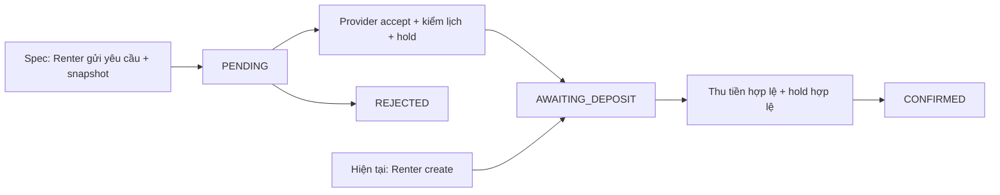
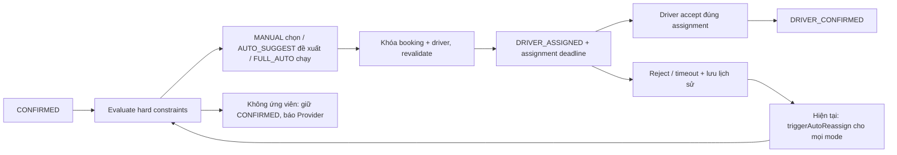
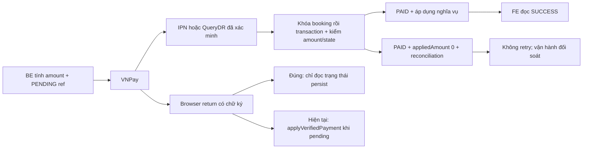
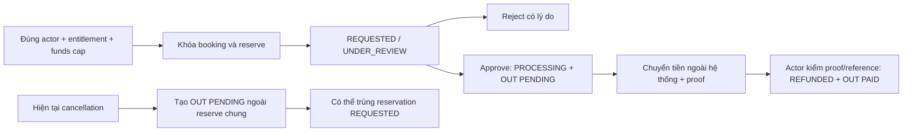
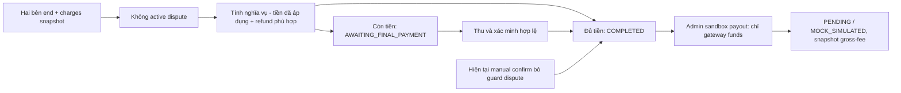

# TV5 — Audit logic nghiệp vụ, kiến trúc và an toàn tài chính

Ngày: **30/10/2026**, Asia/Ho_Chi_Minh. Nhánh: `task-member-5`. HEAD được audit: `58133019a982d486dd161ad5f6ff36391be05ac3`.

**Kết luận: NOT MERGE READY.** Có lỗi P0/P1 chưa sửa, một regression PostgreSQL thất bại và bộ browser chưa xanh. Báo cáo này không thay đổi code production, migration, dữ liệu phát triển, commit, push hoặc PR.

## 1. Phạm vi, phương pháp và giới hạn bằng chứng

Working tree sạch khi bắt đầu. So với `main` local, nhánh có 498 file thay đổi; không fetch hay thay nhánh. Kết quả dưới đây áp dụng cho checkout/HEAD trên, không đại diện trạng thái remote mới hơn.

Đã kiểm tra trực tiếp luồng O07/O08/O11/D01/D02, VNPay, VietQR, refund, payout, các đầu nối Renter/Schedule/Dispute/User/Vehicle, enum, entity, repository, controller, FE service/hook/component và test liên quan. Quét import trên toàn bộ Java production để tìm repository chéo feature, controller gọi repository và import implementation; kiểm tra cấu trúc dependency service. Chín implementation được yêu cầu đều đã được khảo sát; độ sâu tập trung vào đường ghi tiền, khóa, assignment và state machine. Đây không phải bằng chứng rằng mọi method ngoài TV5 hoặc mọi thứ tự cạnh tranh đều đã được kiểm chứng động.

Nguồn đối chiếu: `AGENT_CONTEXT.md`, `Backend/EcoMotion/AGENT_CODE_STRUCTURE.md`, `docs/SBA301_FALL26.md`, `docs/PHAN_CONG_6_THANH_VIEN.md`, `docs/GIAI_THICH_ENTITY_v10.1.md`, `docs/Conceptual_v10.1.mmd`; các tài liệu TV5 chi tiết/cách hoạt động/audit/final/end-user, hai báo cáo trong `docs/reviews`, `MY_CODE_AUDIT_REPORT.md`; tài liệu availability/driver status và SQL liên quan. Các báo cáo cũ chỉ cung cấp ngữ cảnh và ca kiểm thử cần đối chiếu, không được chuyển thành PASS của phiên này.

Quy ước đường dẫn trong bảng: `BE` = `Backend/EcoMotion/src/main/java/com/fptufa26/ecomotion`; `FE` = `Frontend/EcoMotion/src`; `SQL` = `Backend/EcoMotion/src/main/resources/db`; `TEST` = `Backend/EcoMotion/src/test/java/com/fptufa26/ecomotion`. `File:Line` là dòng tại HEAD nêu trên.

Phân loại bằng chứng:

- **CONFIRMED BUG — runtime**: đã thực thi và quan sát kết quả sai.
- **CONFIRMED BUG — static**: có đường gọi/điều kiện/code chứng minh; tình huống được mô tả nhưng chưa chạy riêng regression cho tình huống đó.
- **POTENTIAL RISK**: cần kiểm chứng bổ sung, không được diễn giải thành sự cố đã xảy ra.
- **SPEC CONFLICT**: nguồn quy định mâu thuẫn; không tự chọn tài liệu mới hơn để thay spec chính thức.
- **NOT VERIFIED / NOT_RUN**: chưa có bằng chứng thực thi tương ứng.

## 2. Mâu thuẫn tài liệu và implementation

| Chủ đề | Quy định chính thức | Nguồn khác / code hiện tại | Ảnh hưởng và cách đánh giá |
|---|---|---|---|
| Duyệt trước khi thu cọc | `SBA301_FALL26.md:120`, mục 4.5: gửi yêu cầu, Provider accept rồi trả cọc | `AGENT_CONTEXT.md`, bổ sung 30/10, giữ create trực tiếp AWAITING_DEPOSIT; `BookingServiceImpl` tạo hold/payment request ngay | **SPEC CONFLICT, P1**: đường Renter phổ biến bỏ bước duyệt. Không tự sửa TV2 hoặc coi bổ sung mới là tự động thay spec |
| Lý do Deny | `SBA301_FALL26.md:194`: Deny không cần lý do, không lưu riêng; phân công nhóm cũng ghi không lý do | `ProviderBookingServiceImpl:445` bắt buộc 1–500 ký tự; DTO/modal và tài liệu TV5 đòi lý do | **SPEC CONFLICT, P1**: thêm điều kiện từ chối đơn trái spec chính |
| Return URL | Yêu cầu audit và `AGENT_CONTEXT.md`, bổ sung VNPay 29/10: chỉ đọc; IPN/QueryDR mới ghi tiền | `VnpayServiceImpl:595` gọi apply; `VnpayPaymentFlowIntegrationTest:114` kỳ vọng callback ghi tiền | **Không phải lựa chọn spec còn mở**: implementation/test trái yêu cầu trực tiếp; A01 |
| Kết thúc chuyến | Hai phía xác nhận; chỉ hoàn tất khi đủ nghĩa vụ | Tài liệu TV5 chi tiết cũ ghi actualEndAt ngay khi Driver finish; bổ sung 29/10 và code đợi hai phía | Code hai phía phù hợp yêu cầu audit; không dùng diagram cũ để kết luận lỗi |
| Loại phụ phí | Spec chỉ WAITING/OVERTIME/WEEKEND/OUT_OF_RADIUS, không vệ sinh/hư hỏng | Tài liệu TV5 chi tiết còn liệt kê CLEANING_FEE/DAMAGE_PENALTY/TOLL_FEE; code addCharge whitelist bốn loại | Tài liệu cũ sai; không thêm loại phí để khớp báo cáo cũ |
| Incident và số bảng | Spec gốc loại sự cố hư hỏng/tai nạn khỏi phạm vi; phân công ghi không thêm bảng ngoài schema | Migration advanced có incident/evidence/assignment/refund/payment request; tài liệu TV5 gọi incident là chức năng lõi | **SPEC CONFLICT** về phạm vi/mô hình, không tự xóa bảng hay thư viện |
| Tự gán lại sau từ chối | MANUAL/AUTO_SUGGEST/FULL_AUTO biểu đạt quyền điều phối khác nhau | Tài liệu cách hoạt động và `triggerAutoReassign` tự tìm/gán người mới; không kiểm mode | Cần chốt rõ mode áp dụng cho retry hay chỉ lần đầu; A12 |
| Kết quả audit cũ | Báo cáo 24/10 nói toàn bộ test xanh; báo cáo 29–30/10 có các tổng chọn lọc khác | Checkout hiện tại có test callback thay đổi, PG và browser thất bại | Không cộng số test cũ, không dùng báo cáo cũ để xác nhận lỗi đã sửa |

## 3. Compliance matrix

| Rule từ MD / yêu cầu | File code | Đúng / Sai / Chưa rõ | Bằng chứng |
|---|---|---|---|
| Controller → Service interface → implementation → Repository | Các controller và service auth/booking/finance/user/vehicle/schedule/dispute | Đúng chủ đạo | Constructor dependency dùng interface; quét import không thấy controller import repository |
| Feature A không truy cập repository B | Các implementation production ngoài `seed` | Đúng trong quét import | Finance dùng BookingQueryService/BookingPaymentLedgerService và UserService; không thấy repository chéo trong service nghiệp vụ |
| Không phụ thuộc implementation của service khác | `BE/booking/service/implement/ProviderBookingServiceImpl.java:297,1032` | Sai một phần | Gọi static `DriverTripServiceImpl.deriveExecutionStatus`; không phải inject ServiceImpl nhưng vẫn coupling concrete |
| Mọi application service đặt implementation trong `service/implement` | Chín service trọng tâm | Đúng | Đều có interface và implementation tương ứng |
| Integration client không bắt buộc cơ học theo service pair | `common/cloudinary`, gateway adapters | Chưa rõ phân loại | CloudinaryServiceImpl ở integration package; không tự kết luận sai chỉ từ tên ServiceImpl |
| common chỉ chứa kỹ thuật dùng chung | `common/config`, security, storage, notification stream | Đúng về ownership quan sát được | Không thấy pricing/booking workflow chuyển sang common |
| Không circular dependency | Bean graph khởi tạo trong Spring integration test | Đúng với context đã chạy | Không có lỗi circular bean khi chạy H2 và PostgreSQL; không phải chứng minh mọi profile |
| DTO không trả JPA entity qua REST | `BE/booking/controller/DriverTripController.java:203,212` | Sai | Incident POST/GET trả TripIncident / List<TripIncident>; A10 |
| Snapshot chốt khi create | `BookingServiceImpl`, BookingPolicySnapshot | Đúng ở create đã test | Journey PostgreSQL tạo booking, snapshot và hold cùng giao dịch |
| Mọi tiền/đặc tính đơn cũ lấy snapshot | addCharge, calculateRentalDuration, legacy hold | Sai một phần | addCharge dùng snapshot; duration và fallback legacy còn dùng RentalPlan hiện tại; A09 |
| Provider chỉ đọc đơn của mình | ProviderBookingService/BookingSpecification | Đúng trong ca đã chạy | Unit ownership và PostgreSQL HTTP ownership PASS |
| Queue filter/sort/paging tại DB | `ProviderBookingServiceImpl:864`, ProviderWorkflowSpecification | Đúng | Specification trước `findAll` với QueuePage; PostgreSQL action/date/export PASS |
| Không giữ slot bằng suy đoán gateway thất bại | VehicleScheduleRepository, BookingHoldExpiryServiceImpl | Đúng theo bổ sung 30/10 | PENDING VNPay tiếp tục occupied; PG late-capture PASS |
| Không xác nhận tiền từ Return | `VnpayServiceImpl:595` | Sai | Regression PostgreSQL FAIL; A01 |
| Merchant/amount/signature/status được xác minh | VnpayPaymentGatewayStrategy, applyVerifiedPayment | Đúng ở các kiểm tra đã chạy | HMAC/merchant, exact amount, response code + transaction status; unit và H2 PASS |
| Pending chưa rõ không cho trả lại | createPaymentUrl, transactionResult | Đúng ở nhánh VNPay đã test | Tái sử dụng reference, chặn pending hết hạn, chỉ retry khi đủ điều kiện |
| Auto assignment sau capture chỉ FULL_AUTO | `VnpayServiceImpl:483` | Đúng | Guard FULL_AUTO; afterCommit/REQUIRES_NEW; journey không auto khi mode khác PASS |
| Driver eligible + revalidate sau lock | DriverOptimizationServiceImpl, DriverAvailabilityServiceImpl | Đúng trong bộ chọn lọc | ACTIVE/APPROVED/readiness/GPLX hết khoảng/incident/buffer/rejected và race PG PASS |
| Thiếu GPS không giả thành vị trí xe | Tracking/optimizer, FE LiveMapViewer | Đúng trong kiểm chứng chọn lọc | Stale GPS/ETA tests PASS; GPS thiết bị thật NOT_RUN |
| Driver + Renter xác nhận độc lập | DriverTripServiceImpl, BookingServiceImpl | Đúng trong journey đã chạy | Hai phía start/end được serialize; actualEndAt chốt sau hai phía |
| VietQR là xác nhận thủ công | PaymentRequestServiceImpl, ProviderFinancePage | Đúng về nhãn nguồn | PROVIDER_CONFIRMED, BANK_TRANSFER; không dùng làm tiền nền tảng payout |
| Thanh toán thủ công phải giữ các guard tài chính | `PaymentRequestServiceImpl:558,972` | Sai | Không kiểm hold còn hạn/overlap ở confirmHold; thiếu dispute guard; A02/A03 |
| Hoàn tiền có reserve và proof | RefundServiceImpl | Đúng trong đường gọi riêng | PG reserve/approve/proof/reference races PASS; đường cancellation khác chưa dùng chung reserve; A07 |
| Mock payout không giả bank transfer thật | ProviderFinanceServiceImpl.createSandboxPayout | Đúng trong ca đã test | Admin ACTIVE + flag + profile, PENDING/MOCK_SIMULATED, snapshot gross/fee; direct funds không payout |
| Không hard-code chính sách thay đổi được | `BE/booking/service/DepositRefundRules.java:12` | Sai một phần | 50%, 24h, 30 ngày trong Java; spec giao Admin cấu hình; A08 |
| N+1 / SRP / đơn giản | ProviderBookingServiceImpl, PaymentRequestServiceImpl | Sai một phần | Queue còn gọi risk theo từng dòng; classes rất lớn; A13 |

Seeders có import repository chéo để dựng fixture/dev data; phân biệt với service nghiệp vụ. Không báo cáo các import đó thành vi phạm Service-to-Service của TV5.

## 4. Issue list

Severity áp dụng theo yêu cầu: P0 liên quan tiền/bảo mật/xung đột nghiêm trọng; P1 sai nghiệp vụ/luồng chính; P2 hiệu năng, maintainability, chất lượng kiểm chứng. Chưa ghi nhận P3 riêng vì các vấn đề chức năng cần xử lý trước.

| ID | Severity / loại | File:Line, method | Vấn đề | Root cause | Impact | Proposed fix |
|---|---|---|---|---|---|---|
| A01 | **P0 CONFIRMED BUG — runtime** | `BE/finance/service/implement/VnpayServiceImpl.java:595`, processCallback | Browser return gọi applyVerifiedPayment khi PENDING | Tái dùng writer của IPN cho return | Return có thể ghi PAID/FAILED, CONFIRMED/COMPLETED, lịch, thông báo/auto assignment trái trust boundary được yêu cầu | Callback xác minh dữ liệu rồi chỉ đọc; writer chỉ IPN/QueryDR; sửa test đang kỳ vọng sai |
| A02 | **P0 CONFIRMED BUG — static** | `BE/finance/service/implement/PaymentRequestServiceImpl.java:972`; `BE/schedule/service/implement/ScheduleServiceImpl.java:150` | Provider xác nhận cọc có thể kích hoạt hold hết hạn, không kiểm overlap | confirmPayment không loại EXPIRED/REVIEW_REQUIRED; nhánh AWAITING_DEPOSIT gọi confirmHold chỉ tìm HELD | Hold cũ hết hạn có thể ACTIVE sau khi booking khác đã chiếm xe; hai booking được xác nhận cùng lịch | Khóa booking/xe, recheck deadline + overlap; tiền đã nhận nhưng fulfillment lỗi phải vào đối soát |
| A03 | **P0 CONFIRMED BUG — static** | `BE/finance/service/implement/PaymentRequestServiceImpl.java:558,631`, confirmPayment | Final VietQR có thể COMPLETED khi tranh chấp đang mở | Chỉ chặn CONFIRMED/REJECTED/VOIDED; REVIEW_REQUIRED đi qua; final branch chỉ kiểm booking status | Bỏ qua quyết toán bị giữ do dispute, sai nghĩa vụ tiền/chuyến | Guard active dispute và trạng thái PR được phép dưới khóa; tách nhận tiền thực tế khỏi áp dụng vào quyết toán |
| A04 | **P1 CONFIRMED BUG — static** | `BE/finance/service/implement/PaymentRequestServiceImpl.java:608`; `BE/booking/entity/PaymentTransaction.java:71` | Nhiều lần trả một PR dùng cùng transactionCode | Gán transactionCode = paymentCode của PR thay vì mã mỗi lần chuyển tiền | Lần confirm thứ hai sau PARTIALLY_PAID vi phạm unique; tiền thực nhận chưa được ghi đầy đủ | Sinh code riêng từng transaction, giữ liên kết PR/paymentCode riêng |
| A05 | **P1 CONFIRMED BUG — static** | `BE/finance/service/implement/PaymentRequestServiceImpl.java:1085,1101`; `BE/finance/service/implement/VnpayServiceImpl.java:688` | Các calculator không thống nhất appliedAmount/refund | Zero allocation bị fallback sang amount; VietQR không trừ refund khỏi tiền đã áp dụng; VNPay tính toàn bộ IN | Số còn phải trả/được hoàn và khả năng finalize khác nhau theo endpoint | Dùng một ledger calculation xác định nghĩa vụ, applied funds, refund và reconciliation; không coi zero là missing |
| A06 | **P1 CONFIRMED BUG — runtime** | `FE/pages/PaymentSuccessPage.jsx:20`; `FE/App.jsx:79` | Trang success công khai tự tin query/state và luôn báo server đã xác minh | Không fetch ledger; thiếu guard dữ liệu xác minh | Tạo biên lai thành công giả bằng URL; không làm DB PAID nhưng đánh lừa người dùng | Receipt phải đọc trạng thái server theo transaction/reference được phép; thiếu dữ liệu thì pending/error |
| A07 | **P1 CONFIRMED BUG — static** | `BE/booking/service/implement/ProviderBookingServiceImpl.java:1209`; `BE/booking/service/implement/BookingServiceImpl.java:932` | Cancellation tạo REFUND ledger ngoài bộ reserve của RefundService | Chỉ trừ REFUND PENDING/PAID, không tính RefundRequest REQUESTED/UNDER_REVIEW chưa có OUT ledger | Đặt chỗ hoàn trùng; approve/proof bị chặn do over-reserve, cancellation kẹt review | Tất cả entry point hoàn tiền dùng cùng hạn mức reserve dưới booking lock |
| A08 | **P1 POTENTIAL RISK / SPEC CONFLICT** | `BE/finance/service/implement/RefundServiceImpl.java:50,75,103`; `BE/booking/service/DepositRefundRules.java:12` | Generic refund cap là mọi IN PAID trừ reserve, không policy/stage; policy cancellation hard-code | Hạn mức dòng tiền được dùng như entitlement nghiệp vụ | Renter có thể yêu cầu mức khác refund preview; gói năm/cọc muộn không được policy enforce ở API generic; vẫn cần Provider/Admin duyệt | Tách entitlement theo rule khỏi funds cap; dùng chính sách đã chốt/được phê duyệt; xác định ngoại lệ Admin có audit trail |
| A09 | **P1 CONFIRMED BUG — static** | `BE/booking/service/implement/ProviderBookingServiceImpl.java:1253`; `BE/schedule/service/implement/ScheduleServiceImpl.java:129` | Duration đơn cũ và legacy hold suy từ giá/slot hiện tại | totalAmount / RentalPlan.slotPrice; fallback không snapshot | Sửa giá plan làm UI đổi thời lượng; legacy reissue có thể giữ sai khoảng thuê | Lấy BASE_RENTAL.quantity + snapshot.slotLengthMinutes/planType; thiếu snapshot phải đối soát |
| A10 | **P1 CONFIRMED noncompliance; P0 data exposure POTENTIAL RISK** | `BE/booking/controller/DriverTripController.java:203,212`; `BE/booking/entity/TripIncident.java:39`; `BE/user/entity/User.java:49` | REST trả entity có booking/driver/createdBy/resolvedBy | Không map response DTO; User có getter passwordHash và không ignore ở entity | Có thể serialize thông tin tài khoản/giấy tờ qua graph hoặc lỗi lazy/proxy; chưa chứng minh HTTP leak | Map TripIncidentResponse whitelist trước trả; bổ sung regression HTTP bảo đảm không có passwordHash/giấy tờ/graph nội bộ |
| A11 | **P1 CONFIRMED BUG — static** | `FE/pages/ProviderBookingDetailPage.jsx:139`; `BE/booking/service/implement/ProviderBookingServiceImpl.java:473` | UI vẫn mở gán lại khi backend không cho | canAssignDriver OR trạng thái DRIVER_CONFIRMED/DRIVER_ASSIGNED ngay cả server capability false | Nút điều phối có thể chỉ dẫn tới 409; provider không đổi tài xế bình thường trước chuyến | Dùng capability server thống nhất; nếu nghiệp vụ cho đổi trước chuyến, bổ sung flow recall/reassign có kiểm chứng |
| A12 | **P1 SPEC CONFLICT / POTENTIAL RISK** | `BE/booking/service/implement/DriverOptimizationServiceImpl.java:421,455` | Retry tự gán tài xế kể cả booking MANUAL/AUTO_SUGGEST | triggerAutoReassign không đọc AssignmentMode | Provider có thể mất quyền quyết định người thay thế theo cách hiểu mode | Chốt mode cho retry; nếu chỉ FULL_AUTO được ghi tự động, mode khác chỉ trả suggestion/event |
| A13 | **P2 CONFIRMED static** | `BE/booking/service/implement/ProviderBookingServiceImpl.java:1017`; `BE/booking/service/implement/VehicleOperationalRiskServiceImpl.java:43` | Query theo từng booking, implementation ôm nhiều trách nhiệm | Mỗi toResponse gọi assess query riêng; duration/summary/detail còn nhiều lookup | DB pagination đúng nhưng chi phí vẫn tăng theo số dòng; khó sửa tiền/assignment độc lập | Batch risk/duration; tách orchestration có lý do thực tế, không thêm CRUD wrapper |
| A14 | **P2 POTENTIAL RISK** | `BE/finance/service/implement/PaymentCodeGeneratorImpl.java:23,26` | Lần khởi tạo prefix chưa tồn tại đua giữa nhiều JVM | synchronized chỉ trong JVM; SELECT FOR UPDATE không khóa dòng chưa có | Một request có thể lỗi PK/optimistic conflict; DB không cho lưu mã trùng nhưng availability giảm | Seed prefix và atomic upsert/increment tại DB hoặc retry conflict có giới hạn |
| A15 | **P2 CONFIRMED test/quality gap** | `Frontend/EcoMotion/e2e/tv5-ui-audit.spec.js:159,259`; `FE/pages/PaymentSuccessPage.jsx:15` | Browser 5 fail; lint 23 error/11 warning | Locator không scope responsive layout, timeout payment chưa rõ, code thừa/hook issues | Không đủ điều kiện tuyên bố mandatory checks hoàn tất | Sửa locator/test fixture theo root cause; điều tra timeout; xử lý lint đúng scope trước merge |
| A16 | **P2 POTENTIAL RISK / NOT VERIFIED** | `SQL/schema.sql:708`; `SQL/migrations/20261030_payment_workflow_fix.sql:23` | Test create-drop entity không kiểm chứng đường upgrade SQL hiện hữu | CHECK method trong base schema không gồm VNPAY; migration mã backfill bằng ID, LPAD sáu ký tự | Cần kiểm tra full chain nâng schema, dữ liệu cũ, code đã cấp và boundary ID; không được suy từ H2/PG Hibernate schema | Chạy chain trên DB trắng/bản sao dữ liệu đã ẩn danh, replay có kiểm chứng; không chạy schema.sql lên dữ liệu thật |

### 4.1. Tái hiện và bằng chứng quan trọng

**A01 đã tái hiện trên PostgreSQL 18.6 riêng.** `Tv5PostgresConcurrencyTest.repeatedIpnIsSerializedAndCallbackDoesNotConfirmMoney` thất bại tại `TEST/booking/service/Tv5PostgresConcurrencyTest.java:381`: callback đã đổi trạng thái, trái kỳ vọng PENDING. Gateway ở test này được mock tại boundary; đây là bằng chứng writer của callback, không phải giao dịch ngân hàng thật. Bộ H2 lại có `VnpayPaymentFlowIntegrationTest.returnBeforeIpnVerifiesDirectlyAndSubsequentIpnIsIdempotent` PASS vì test tại dòng 114–138 kỳ vọng chính hành vi sai. Không sửa assertion để che regression trong phiên audit.

**A02 kịch bản static:** booking A AWAITING_DEPOSIT có HELD đã hết expiresAt, PR chưa được scheduler xử lý. B đặt cùng xe/giờ vì hold A hết hạn. Provider confirm tiền A trước khi scheduler dọn A: confirmPayment chấp nhận PR; confirmDepositAndLockSchedule khóa xe nhưng gọi confirmHold không kiểm expiresAt/overlap B. Khóa xe chỉ tuần tự hóa, không thay được revalidation. Kịch bản chưa chạy riêng; bằng chứng là hai method trên và predicate loại hold hết hạn trong VehicleScheduleRepository.

**A03 kịch bản static:** tạo final payment request → Renter mở CHARGE dispute khi booking còn AWAITING_FINAL_PAYMENT → PR REVIEW_REQUIRED → Provider gọi confirmPayment với đủ receivedAmount và bank ref/note. Guard hiện tại không loại REVIEW_REQUIRED và không kiểm dispute; final branch chuyển booking COMPLETED. VNPay có dispute guard riêng nên test VNPay dispute PASS không bao phủ lỗi VietQR này.

**A04 kịch bản static:** PR có paymentCode VQ000123; lần đầu xác nhận 40% tạo transaction VQ000123/PARTIALLY_PAID; lần tiếp xác nhận 60% lại insert VQ000123. Unique trên entity và migration làm lần hai rollback. Một payment request được trả nhiều lần là use case có trong spec; không thể chữa bằng cách bỏ unique của transaction code.

**A05 ví dụ calculator:** nghĩa vụ 1.000, incoming PAID amount=300/appliedAmount=0 vì cần reconciliation vẫn bị calculateRemainingAmount trừ 300. Ví dụ khác: incoming/applied 1.000 và refund PAID 200, VietQR calculator trả 0, VNPay calculator trả 200. Đây là đối chiếu công thức nguồn, chưa phải unit test vừa tạo/chạy. Cần xác định allocation của refund để tránh trừ thừa tiền chuyển dư.

**A06 đã chạy browser probe:** mở `/payment/success?bookingCode=AUDIT-UNPAID&amount=999999&transactionCode=FORGED`, mock API chỉ trả dữ liệu rỗng. Quan sát H1 `Thanh toán thành công!`, booking và transaction giả đều hiển thị. Request quan sát chỉ là `/api/auth/refresh`, `/api/auth/me`; không có payment verification. Không dùng probe này để kết luận backend bị giả PAID. Callback page sau SUCCESS tự điều hướng sang trang này sau một giây, nên đây là phần của luồng thanh toán chính.

**A07 kịch bản static:** đã thu 300; Renter tạo RefundRequest REQUESTED 300 (đã reserve, chưa có OUT transaction). Provider CANCEL_AND_REFUND tính pendingRefund từ ledger bằng 0 và tạo thêm OUT PENDING 300. RefundService sau đó thấy nghĩa vụ reserve 600 > received 300 nên từ chối approve/proof. Guard hoàn tiền ngăn trả quá mức nhưng luồng phục hồi bị kẹt; không kết luận đã thực chuyển hai lần.

**A09 ví dụ static:** đơn gốc 4 slot × 100.000 = 400.000. Provider sửa plan thành 200.000; calculateRentalDuration chia totalAmount cho giá mới và hiển thị 2 giờ. Snapshot/BASE_RENTAL của đơn vẫn là 4 slot. Fallback newLegacyHold dùng cùng phép suy ra có thể ảnh hưởng lịch chứ không chỉ nhãn.

### 4.2. Rủi ro bổ sung chưa nâng thành confirmed bug

- `BookingServiceImpl.cancel:665` đọc requireOwned không khóa booking từ đầu, khác order của RefundService/VNPay. Booking có @Version nên không thể chỉ từ thiếu pessimistic lock kết luận hai cancellation đều commit; cần race cancel vs createRefund/IPN, bao gồm writer chỉ khóa mà không đổi version.
- PaymentRequestRepository.findByIdForUpdate JOIN FETCH booking/renter/user; lock footprint thực tế phụ thuộc SQL/dialect. Các writer có thứ tự PR-first và booking-first khác nhau. Chưa bắt được deadlock; cần test lock order thay vì khẳng định annotation tự khóa đúng tất cả bảng.
- `escapeCsv:894` chỉ escape quote/comma/newline, không neutralize công thức spreadsheet. Cần thử dữ liệu không tin cậy bắt đầu bằng `=`, `+`, `-`, `@`; chưa chạy payload thực thi công thức.
- QueryDR giữ booking/transaction lock trong lúc HTTP timeout; cần đo latency/contention và thiết kế apply dưới khóa sau khi query nếu cần. Không tự bỏ khóa/idempotency.
- Cặp tiền direct/platform đã tách khi payout; refund mixed source chưa có allocation nguồn đầy đủ. Hiện payout chặn trường hợp không phân bổ được; đó là giới hạn phục hồi, không được đổi thành payout thành công giả.
- Unknown gateway có thể giữ slot lâu theo quyết định bổ sung. Đây là tradeoff đã ghi nhận, cần vận hành xử lý giao dịch treo; không tự giải phóng khi chưa rõ có thu tiền.

## 5. Kiến trúc, SOLID và đánh giá chín service

| Service | Quan sát thực tế | Đánh giá / refactor nhỏ có ích |
|---|---|---|
| ProviderBookingServiceImpl, 1.488 dòng | Queue, DTO/timeline/CSV, accept/deny, assignment, charges, settlement, operational change, tracking | SRP yếu; ưu tiên tách calculation/projection đang sai và batch query. Không tạo một tầng CRUD mới cho mọi repository |
| DriverOptimizationServiceImpl, 753 dòng | Eligibility, ranking, assign/reassign, timeout, history | Dùng chung hard constraints và recheck sau driver lock là điểm tốt; cần chốt retry mode và giảm duplication hai đường assign |
| DriverAvailabilityServiceImpl, 177 dòng | Batch schedule/snapshot/charges; tương lai, overdue/uncertain, buffer | Trách nhiệm hợp lý. Chưa suy rảnh chỉ vì qua ngày mới; không tự refactor khi chưa có lỗi |
| DriverTripServiceImpl, 1.119 dòng | List/detail, transition, GPS, incident/evidence façade | Hai phía và owner guard tốt trong ca chạy; trả entity ở controller cần thay DTO; static derive dùng từ implementation khác cần đưa projection sang nơi phù hợp |
| VnpayServiceImpl, 748 dòng | Create/query/return/IPN, amount calculation, fulfillment | Cần sửa trust boundary A01 trước; số tiền duplicate với PaymentRequestService là lý do thực tế để thống nhất calculator |
| PaymentRequestServiceImpl, 1.293 dòng | PR, evidence, manual confirm/reject/issue, simulate, amount, VietQR | Nhiều rule tài chính không tương đương VNPay; A02–A05 ưu tiên. Tách sandbox khỏi core nếu làm giảm rủi ro sửa logic thật |
| RefundServiceImpl, 436 dòng | Authorization, reserve, review, proof, file lifecycle | Lock/reserve/proof hợp lý ở entry point này; không bảo đảm cancellation ngoài service tuân cùng invariant |
| ProviderFinanceServiceImpl, 881 dòng | Bank account, summary, breakdown, commission, payouts | Nguồn tiền payout đã tách; giới hạn dữ liệu lịch sử/mixed refund cần giữ rõ; summary lấy toàn bộ transactions cần benchmark |
| BookingQueryServiceImpl, 237 dòng | Façade nhiều CRUD và lock/refresh | Che repository chéo có tác dụng, nhưng trả mutable entity chưa là ranh giới nghiệp vụ mạnh. Không thêm wrapper nữa; tập trung method theo use case/DTO khi sửa |

Không thấy inject concrete service thay interface trong quét import. Có static coupling cùng feature tới DriverTripServiceImpl, cần phân biệt với quy tắc cấm inject implementation feature khác. Các `@Transactional` tự gọi method trong cùng class như createFinalPaymentUrl→createPaymentUrl, autoAssign→autoAssignWithResult có outer transaction nên chưa chứng minh transaction bị mất. Không gán lỗi self-invocation máy móc chỉ vì thấy lời gọi nội bộ.

CP-SAT hiện tạo `addExactlyOne` trên danh sách eligible và tối thiểu weighted penalty. Với một booking, bài toán tương đương chọn min penalty; sort + tie-break đơn giản hơn về vận hành. Tuy vậy thư viện có native test, yêu cầu dự án và fallback rõ ràng; **không đề xuất xóa OR-Tools trong audit này**. Fallback vẫn lọc eligible và đường ghi kiểm lại; không có bằng chứng fallback bỏ hard constraints. Nếu sau này tối ưu nhiều booking/driver cùng lúc, CP-SAT mới cung cấp lợi ích vượt phép chọn min hiện tại.

## 6. Workflow đúng và workflow hiện tại

Các sơ đồ chỉ thể hiện các bước liên quan kết luận audit; không thay enum hoặc spec. Thời gian server và dữ liệu persist quyết định state.

### 6.1. Booking



Nhánh H là mâu thuẫn manual approval với spec chính, dù đã được giữ trong AGENT_CONTEXT. Hold hết hạn không có pending gateway phải được giải phóng; pending gateway phải đối soát trước kết luận.

### 6.2. Driver assignment



Recalled assignment và latest matching assignment ngăn driver cũ nhận chuyến người khác. Ca same-driver tab cũ có assignedAt được guard, đặc biệt sau consent. Retry mode I cần chốt quy định; không đổi thành tự hủy khi không có người.

### 6.3. Trip lifecycle

```mermaid
flowchart LR
  A[DRIVER_CONFIRMED] --> B[DRIVER_ARRIVED]
  B --> C[Driver start]
  C --> D[AWAITING_START_CONFIRMATION]
  D --> E[Renter start: IN_PROGRESS + actualStartAt]
  E --> F[Driver finish]
  F --> G[AWAITING_END_CONFIRMATION]
  G --> H[Renter end: actualEndAt]
  H --> I[AWAITING_EXTRA_CHARGE_CONFIRMATION]
  I --> J[Provider finalize, không dispute]
  J --> K[AWAITING_FINAL_PAYMENT hoặc COMPLETED nếu đủ tiền]
  K --> L[Thu phần còn lại hợp lệ: COMPLETED]
```



Hai phía có thể xác nhận theo thứ tự được guard ở method tương ứng; hai timestamp độc lập, actual timestamps chốt khi đủ hai phía. Đây là trạng thái code đã test, rộng hơn sơ đồ rút gọn trong prompt. AWAITING_END_CONFIRMATION vẫn chiếm tài xế; AWAITING_FINAL_PAYMENT chưa có nghĩa hoàn tất tài chính. Không suy trip thành công chỉ từ event TRIP_COMPLETED mà phải refetch state server.

### 6.4. Payment



Chữ ký return hợp lệ không thay đổi yêu cầu trust boundary chỉ IPN/QueryDR ghi tiền. VietQR là nhánh Provider manual confirm, không phải bank auto reconciliation; cần cùng invariant hold/dispute/ledger như nhánh VNPay.

### 6.5. Refund



Không có lời gọi VNPay refund thật mới trong luồng proof. Proof là xác nhận thủ công, không phải xác thực độc lập từ ngân hàng. REFUNDED chỉ sau PAID, không sau APPROVE.

### 6.6. Settlement và payout



Payout mock hiện không khẳng định đã chuyển tiền ngân hàng; cần giữ behavior này. Nguồn direct Provider đã nhận không được đưa vào held funds.

## 7. Frontend và API contract theo hành động

Các endpoint bên dưới là đường FE gọi thực tế, sau baseURL `/api`. Alias BE khác vẫn tồn tại. Response thông thường bọc `ApiResponse.data`. Đây là mapping source; chỉ những case ghi PASS ở phần 9 mới có bằng chứng thực thi. Không coi mọi nút đã được click với server thật.

Quy ước L/S/E: loading hoặc disable trong lúc mutation; success hiển thị thông báo/đọc response; error hiển thị và cho thử lại. Hook detail/queue có sequence chống phản hồi cũ; useRealtimeSync có SSE/focus/online/polling 15 giây và refetch. Các trạng thái suy diễn FE/capability sai được tách ở A11.

| Chức năng / component | Method + endpoint sau /api | Payload / filter | Response DTO | Actor; trước → sau | L/S/E, API thật và refresh |
|---|---|---|---|---|---|
| O07 lọc/sort/page — ProviderBookingQueuePage | GET `/provider/bookings/paged` | status/action/vehicle/driver/dateFrom/dateTo/sort/offset/limit | PageResponse<ProviderBookingResponse> | Provider, read | API thật; hook loading/error, đổi filter refetch; count tại DB |
| O07 thống kê | GET `/provider/bookings/summary` | none | ProviderBookingSummaryResponse | Provider, read | API thật; chưa chứng minh summary dùng đúng mọi filter UI |
| O07 CSV | GET `/provider/bookings/export` | cùng filter | text/csv | Provider, read | Blob download; cùng filter BE; cap 10.000; browser interactive test đang fail locator trước khi kiểm hết |
| O08 detail/risk/workflow — useProviderBookingDetail | GET `/{provider/bookings}/{code}`, `.../operational-risk`, `.../workflow` | code | ProviderBookingDetailResponse / OperationalRiskResponse / BookingWorkflowResponse | Provider owner, read | API thật; Promise.allSettled + key/sequence; main row lỗi hiển thị retry |
| Accept — AcceptBookingModal | POST `/provider/bookings/{code}/accept` | none | ProviderBookingResponse | Provider; PENDING → AWAITING_DEPOSIT | Disable/loading, toast/error, onSuccess refetch; hold/payment request cùng transaction |
| Deny — DenyBookingModal | POST `.../{code}/deny` | reason | ProviderBookingResponse | Provider; PENDING → REJECTED | API thật; bắt reason trái spec chính; refresh |
| Mở ứng viên — AssignDriverModal | GET `.../{code}/assign-candidates` | code | List<DriverCandidateResponse> | Provider owner, read | API thật; eligible/reason/availability từ BE; loading/error |
| Gợi ý | POST `.../{code}/assign-suggest` | none | AssignmentSuggestionResponse | Provider; không ghi assignment | API thật, solverStatus/fallback hiện rõ; không tự coi suggestion đã gán |
| Gán tay / xác nhận ứng viên | PUT `.../{code}/driver` | driverId, mode | ProviderBookingResponse | Provider; CONFIRMED hoặc replacement hợp lệ → DRIVER_ASSIGNED | API thật; disable, error 409, refresh candidates/detail; A11 |
| Full auto | POST `.../{code}/auto-assign` | none | AutoAssignmentResponse {booking,solverStatus} | Provider; eligible → DRIVER_ASSIGNED | API thật; không ứng viên trả error; thành công vẫn chờ Driver |
| Đổi xe/giờ/hủy — OperationalRiskPanel | POST `.../{code}/operational-resolution` | resolution,replacementVehicleId?,newPickupTime?,reason | OperationalResolutionResponse | Provider; propose hoặc cancellation review | API thật; proposal không đổi xe/giờ ngay; refetch; hủy là mutation cần xác nhận |
| Renter phản hồi đề xuất — BookingWorkflowSummary | PUT `/renter/bookings/{code}/operational-proposal/{uuid}` | action,reason | Workflow response | Renter owner; pending proposal → accepted/rejected | API thật; lỗi không giả ACCEPTED; PG consent rollback và browser hai tab PASS |
| Rút đề xuất | DELETE `/provider/bookings/{code}/operational-proposal/{uuid}` | none | Workflow response | Provider; pending → withdrawn | API thật, refetch; stale uuid bị guard |
| Thêm phụ phí — AddChargeModal | POST `.../{code}/charges` | chargeType,quantity,description,evidenceUrl; giá client không được tin | BookingChargeResponse | Provider; AWAITING_EXTRA_CHARGE_CONFIRMATION | API thật; formula preview; server tính lại snapshot, stage/yearly guard, refetch |
| Chốt — ProviderBookingDetailPage | POST `.../{code}/settlement/finalize` | none | SettlementResultResponse | Provider; extra-charge → final-payment/completed | finalizing/disable; toast theo result.status; refetch |
| Incident/evidence/tracking | GET/POST `.../{code}/incidents`, `/incidents/{id}/resolve`, `/evidence`, `/tracking`, `/location` | resolutionNote; file/type/note theo action | Incident/evidence/tracking DTO; Driver incident còn entity | Provider/Driver đúng owner | API thật; partial fetch, polling và refresh; upload/GPS thật NOT_RUN |
| D01 lịch/active — DriverSchedulePage | GET `/v1/driver/trips` | view/status/date/page/size/sort | PageResponse<DriverTripSummaryResponse> | Driver, read own | API thật; TODAY/UPCOMING/HISTORY/REQUESTS; polling/focus |
| D02 detail | GET `/v1/driver/trips/{code}` | code | DriverTripDetailResponse | Driver assigned, read | API thật; loading/error/refetch; persist qua reload |
| Driver nhận | POST `.../{code}/confirm` | assignedAt | DriverTripDetailResponse | Driver; DRIVER_ASSIGNED → DRIVER_CONFIRMED | API thật; assignment timestamp/deadline/owner/eligibility guard |
| Driver từ chối — DriverRejectTripModal | POST `.../{code}/reject` | rejectionReason,rejectionNote | DriverTripDetailResponse | Driver; pending assignment → rejected/reassign | API thật; required reason; refresh; mode retry A12 |
| Driver đến / start / finish | POST `.../{code}/{arrive,start,finish}` | none | DriverTripDetailResponse | Driver; arrived / chờ Renter start / chờ Renter end | API thật; disable/error; refetch; chưa đủ hai phía không COMPLETED |
| Driver không thể nhận | POST `.../{code}/report-unavailable` | reason | DriverTripDetailResponse | Driver trước start → replacement required | API thật; Provider refetch thấy issue |
| GPS — useDriverLocationTracker | POST `.../{code}/locations` | lat/lng/recordedAt + metadata theo DTO | TripLocationResponse | Driver hiện hành, active trip | navigator.geolocation; API thật; không có data không giả tọa độ |
| Renter start/end | POST `/renter/bookings/{code}/{confirm-start,confirm-end}` | theo endpoint | ConfirmStartResponse / ConfirmEndResponse | Renter owner; chốt hai phía | API thật; PG serialize PASS |
| O11 summary/transactions/payouts | GET `/v1/provider/finance/{summary,transactions,payouts}` | type/offset/limit theo API | Summary / PageResponse<Transaction/PayoutSummary> | Provider, read own | API thật; source direct/platform và mock badge; browser finance PASS |
| Thêm/sửa bank — ProviderFinancePage | POST/PATCH `/v1/provider/finance/bank-accounts[/{id}]` | bankCode,accountNumber,accountHolderName,status theo request | ProviderBankAccountResponse | Provider owner | API thật; validate, loading/error/refetch; STK response masked |
| Xác nhận direct payment | POST `/v1/provider/payment-requests/{id}/confirm` | receivedAmount,bankTransactionRef,note | PaymentRequestResponse | Provider owner; pending/partial/review → partial/confirmed | API thật; L/S/E/refetch; A02–A05 chưa được UI che chắn an toàn |
| Reject/report issue direct | POST `.../{id}/{reject,report-issue}` | rejectionReason / issueNote theo DTO | PaymentRequestResponse | Provider owner | API thật; không được gọi là bank auto verification |
| Request/review refund | POST `/v1/refunds` hoặc provider finance alias; POST `.../refunds/{id}/review` | bookingCode,amount,reason; action,rejectionReason? | RefundResponse | Participant request; Provider/Admin review | API thật; approve chỉ PROCESSING; reload/refetch; generic policy A08 |
| Proof refund — RefundProofModal | POST `/v1/payment-transactions/{id}/refund-proof` multipart | file,bankReference,note? | RefundProofResponse | Provider owner/Admin; PENDING → PAID | API thật; duplicate guard/reference; chỉ sau response mới hiển thị refunded |
| Tạo VNPay — CustomerPaymentPage | POST `/v1/payment/vnpay/create-url` | bookingCode,paymentType,bankCode?,language? | VnpayPaymentUrlResponse | Renter owner; PENDING gateway transaction | API thật, backend amount; loading/error; redirect URL response |
| Return/query — VnpayCallbackPage | GET `/v1/payment/vnpay/callback`, `/query` | signed gateway params / bookingCode,vnpTxnRef | VnpayCallbackResultResponse | Public reference return/read | API thật; bounded 40 polls, AbortController; A01 backend writer |
| Receipt — PaymentSuccessPage | Navigation `/payment/success` | router state / query string | Không đọc DTO server | Public, tự hiển thị thành công | **Không có API xác minh**; A06 |

## 8. Database và concurrency

### 8.1. Entity, SQL và điều kiện deploy

Booking có @Version; RefundRequest/PaymentRequest/Provider có optimistic version ở mô hình liên quan. PaymentTransaction không có @Version nhưng writer gateway/refund dùng pessimistic locks và refresh. Không coi thiếu @Version ở mọi bảng là lỗi nếu invariant đã được khóa đúng. DriverAssignment có history và matching current assignment; chưa thấy exclusion/unique DB bảo vệ toàn bộ driver time conflict, nên các writer ngoài ứng dụng vẫn là rủi ro.

Schema/migrations có FK, CHECK money/direction/status/range, indexes booking-driver-status-pickup, schedule, charge, transaction; snapshot unique booking; partial unique reference refund. Migration VNPay thêm GATEWAY_VERIFIED và unique vnp_txn_ref; migration payment workflow thêm code unique và sequence table; migration consent thêm nullable proposal columns/unique UUID. Không đề xuất thêm entity mới để sửa A01–A11. PaymentCodeSequence mới đã tồn tại ở checkout, không phải đề xuất thêm của audit.

`schema.sql` có DROP TABLE và được mô tả là bootstrap phá dữ liệu; **không phải migration nâng cấp không mất dữ liệu**. Không chạy file này lên database thật. Test PostgreSQL phiên này dùng schema Hibernate create-drop trong cluster mới, không chứng minh SQL migration chain/replay/backfill đã đúng. A16 cần riêng test migration với dữ liệu cũ, constraint CHECK và unique trước deploy. Nếu dữ liệu cũ trùng reference, migration phải dừng để điều tra, không xóa để chạy qua.

Số tiền charge dùng BigDecimal/snapshot và precision guard. Payout giữ snapshot gross/fee, không cộng DEPOSIT vào doanh thu hai lần. CommissionRate đọc Provider khi tạo payout; spec chưa quy định rõ chốt commission ở booking nên chỉ đánh dấu cần chốt policy, không kết luận phải đổi snapshot hiện tại.

### 8.2. Tám tình huống race bắt buộc

| # | Race | Bằng chứng phiên này | Kết quả / giới hạn |
|---|---|---|---|
| 1 | Hai Renter đặt cùng xe/giờ | Create khóa Vehicle và kiểm availability/hold; `BookingServiceImpl:224` | **NOT_RUN race đúng tình huống**; journey create riêng PASS không thay test hai request đồng thời |
| 2 | Hai request gán cùng Driver | PG overlappingManualAssignmentsHaveOneWinner, manualVersusAutoCannotDoubleBook | **PASS**, hai transaction riêng; hard constraints recheck sau lock |
| 3 | Driver accept vs timeout | PG expiredConfirmCannotBeatTimeout; staleTimeoutCannotReplaceCurrentAssignment | **PASS** cho các interleaving đã thử; không chứng minh mọi lịch chạy scheduler |
| 4 | Driver reject vs Provider đổi Driver | PG replacementRecallsOldAssignmentAndRejectsOldDriver; rejectVersusConfirmAllowsOnlyOneTransition | Hai regression liên quan **PASS**; race đúng reject-vs-provider-replacement **NOT_RUN** |
| 5 | IPN vs callback đồng thời | PG repeatedIpnIsSerializedAndCallbackDoesNotConfirmMoney | **FAIL** tại callback read-only trước khi tới phần race còn lại; không ghi PASS concurrent IPN từ test bị dừng. H2 concurrent IPN riêng PASS |
| 6 | Hai refund request một booking | PG concurrentRefundRequestsCannotReserveMoreThanCollectedMoney; approve/proof race | **PASS** trong RefundService; cancellation vs reserve chéo entry point **NOT_RUN**, A07 |
| 7 | Hold expiry vs capture | PG workflow pendingGatewayKeepsExpiredHoldOccupiedAndLateCaptureRequiresReconciliation | **PASS** cho trạng thái late capture; hai thread scheduler-vs-IPN đúng thời khắc **NOT_RUN** |
| 8 | Hai tiến trình tạo payment code | Pessimistic sequence + unique transaction/paymentCode; code static review | **NOT_RUN multi-process**, A14; synchronized không chứng minh nhiều JVM |

Các test PG không mock optimizer/ledger/state machine; gateway verification/maps/notification/storage được mock ở boundary theo từng lớp. Không đồng nhất PG race test có mock gateway với VNPay integration thật.

## 9. Kiểm thử đã chạy và E2E matrix

### 9.1. Kết quả tái lập trong phiên audit

| Lượt | Loại | Kết quả thực tế | Diễn giải |
|---|---|---|---|
| `npm.cmd test` | Frontend Node unit/contract | **103 PASS, 0 fail** | Không kiểm chứng bank/network/database |
| `npm.cmd run build` | Frontend production build | **PASS** | Warning chunk >500 kB còn tồn tại |
| `npm.cmd run lint` | Toàn FE | **FAIL: 23 errors, 11 warnings** | Có unused symbols/hooks; gồm file ngoài TV5. Không sửa ngoài audit |
| Maven selected 11 classes | Unit + Spring/H2 + native/gateway local | **140 run: 137 PASS, 3 FAIL, 0 error/skip; BUILD FAILURE** | Ba failure NativeDriverSelectionTest do sandbox AccessDenied đọc native JAR |
| Chạy lại riêng NativeDriverSelectionTest | Native OR-Tools | **4 PASS; BUILD SUCCESS** | Được quyền đọc Maven cache; JNI chạy thật, gồm fallback test. Không cộng bốn test lặp vào tổng 140 |
| Tv5PostgresConcurrencyTest | PostgreSQL 18.6 riêng | **19 run: 18 PASS, 1 FAIL** | A01 thất bại; không dùng báo cáo cũ để ghi 19 PASS |
| EndUserWorkflowIntegrationTest | PostgreSQL 18.6 riêng | **15 PASS** | Happy path, consent, ownership, no-driver, late capture, dispute journey có mock dịch vụ ngoài |
| BookingNotificationServiceTest, NotificationStreamServiceTest, PaymentReconciliationJobTest | Unit: notification sau commit / reconciliation batch | **10 PASS; BUILD SUCCESS** | Job disabled không đọc/gọi gateway; lỗi một payment không bỏ phần còn lại trong batch |
| Playwright toàn directory | Chrome headless, API mocked | **43 run: 38 PASS, 5 FAIL, 0 skipped/flaky** | Bốn queue locator strict-mode; một payment-error timeout |
| Probe URL receipt giả | Browser, API mocked | **FAIL theo yêu cầu an toàn UI** | Trang success hiển thị fake booking/code và khẳng định verified; A06 |

Lượt backend ban đầu và lượt native chạy lại được trình bày riêng để không biến BUILD FAILURE thành một build xanh chưa chạy. Sau rerun, cả 140 test độc lập của nhóm đầu đã có kết quả PASS ở lần chạy thích hợp, nhưng test VNPay trong nhóm đó vẫn có assertion trái rule A01. Bộ PG có 34 test độc lập, 33 PASS/1 FAIL. Không gọi toàn bộ repository test là PASS.

Maven chạy offline bằng binary 3.9.16 có sẵn, Java source target theo POM 21; không sửa POM. Không chạy build clean. Không dùng cấu hình runtime chứa credential. H2 lấy test properties. PostgreSQL initdb mới tại `Backend/EcoMotion/target/tv5-audit-postgres`, chỉ bind `127.0.0.1:64335`, database/user `tv5_test`; đã dừng sau kiểm chứng. Không chạm database phát triển/chia sẻ.

Lần Playwright theo config gốc thực thi case nhưng treo ở quản lý webServer/teardown Windows. Đã chạy lại bằng config tạm trong `node_modules/.cache/tv5-audit` chỉ bỏ quản lý webServer, giữ test directory, Chrome, timeout/baseURL và workers=2; JSON reporter có kết quả kết thúc đầy đủ. Không sửa spec hay bỏ assertion. Screenshot tracked do test ghi đã khôi phục về HEAD; artifacts audit chuyển vào target ignored.

### 9.2. E2E / regression matrix

PASS dưới đây chỉ áp dụng lớp kiểm chứng được ghi ở cột Actual Result. Không chuyển PASS unit/MockMvc thành PASS browser nối server thật.

| ID | Actor | Preconditions | Action | Expected Result | Actual Result | Status |
|---|---|---|---|---|---|---|
| TC01 Happy | Renter/Provider/Driver | Fixture mới, driver eligible, snapshot | Create, deposit, assign, start/end hai phía, final payment | Đúng hold/state, đủ tiền mới completed | PostgreSQL EndUserWorkflow journey chạy thật service/DB, external boundary mock | PASS |
| TC02 Happy | Provider | Booking PENDING, xe trống | Accept | Hold có hạn + request deposit | PostgreSQL pendingApprovalBranch... | PASS |
| TC03 Bad | Provider khác | Booking thuộc Provider A | Xem/gán/incident | 403/không đọc/sửa sai owner | Unit eligibility + PG incident HTTP | PASS |
| TC04 Boundary | Driver | Lịch liền kề/buffer | Evaluate/assign | Biên mở khi buffer 0; buffer áp một lần | AssignmentAvailabilityTest, H2/unit | PASS |
| TC05 Boundary | Driver | GPLX hết hạn trước ngày cuối | Assign | Không eligible | DriverAssignmentEligibilityTest | PASS |
| TC06 Recovery | Provider | Không driver eligible | Auto assign/propose/cancel | Không fake assignment/tự hủy; consent và refund đúng | PostgreSQL noDriverRenterRejectsAlternative... | PASS |
| TC07 Security | Renter khác | Proposal UUID của người khác | Respond/read | Không đổi dữ liệu | PostgreSQL consentHttpChecks... và cannotOverwrite... | PASS |
| TC08 Concurrency | Hai Renter tabs | Proposal pending | ACCEPT/REJECT đối nghịch | Một quyết định persist | PG workflow consent và mocked-browser hai tab | PASS cho các case đã thực thi |
| TC09 Concurrency | Provider | Hai booking overlap một Driver | Assign manual/manual, manual/auto | Một người thắng | PG overlappingManual... và manualVersusAuto... | PASS |
| TC10 Recovery | Driver | Assignment expired hoặc recalled | Confirm bằng tab cũ | Conflict, assignment mới giữ nguyên | PG staleTimeout/replacement/expiredConfirm | PASS |
| TC11 Lifecycle | Driver/Renter | Trip active | Finish một phía rồi cả hai | Chưa đủ hai phía không actualEnd/completed | PG startAndEndFromBothActors... + end-user journey | PASS |
| TC12 Bad | Driver | Tài khoản LOCKED/SUSPENDED | Lifecycle API/service | Access denied | DriverTripServiceUnitTest | PASS — unit |
| TC13 Payment security | Gateway | PENDING txn | Signature/merchant/amount sai | Không ghi PAID | Gateway unit và VnpayPaymentFlow H2 | PASS |
| TC14 Payment failure | Renter | Return trước IPN | Callback | Ledger vẫn PENDING, chặn retry | PostgreSQL callback regression đổi trạng thái | **FAIL A01** |
| TC15 Payment recovery | Gateway | PENDING hết hold | Late capture | PAID/reconciliation, không confirmed/retry | PostgreSQL workflow late capture | PASS |
| TC16 Payment failure | Gateway | Final checkout rồi dispute | Verified IPN | Giữ tiền PAID nhưng không completed | Tv5FinancialSafetyIntegrationTest H2 | PASS |
| TC17 Payment failure | Provider | Final PR REVIEW_REQUIRED do dispute | Manual confirm | Không complete nghĩa vụ disputed | Có đường code bypass; chưa chạy riêng | NOT_RUN, confirmed static A03 |
| TC18 Payment boundary | Provider | PR PARTIALLY_PAID có paymentCode | Confirm lần hai | Ghi transaction riêng đủ số tiền | Trùng unique code theo source | NOT_RUN, confirmed static A04 |
| TC19 Concurrency | Provider/Gateway | Hold A hết hạn, B giữ cùng xe | Confirm thủ công A | Đối soát; không active lịch xung đột | Thiếu guard trong source | NOT_RUN, confirmed static A02 |
| TC20 Refund | Provider | Refund REQUESTED | Approve rồi upload proof | PROCESSING trước; sau proof mới refunded | PG refundApproveAndProof... + mocked-browser refund | PASS |
| TC21 Refund concurrency | Hai requests | Đã thu N | Reserve >N hoặc duplicate proof/reference | Không vượt cap/ghi hai lần | PG refund reserve/reference/approve/proof | PASS |
| TC22 Refund recovery | Provider/Renter | RefundRequest đã reserve, chưa ledger | Cancellation | Tái sử dụng reserve | Đường code tạo reserve thứ hai; chưa chạy riêng | NOT_RUN A07 |
| TC23 Payout | Provider/Admin | Direct/platform mixed, completed | Sandbox payout | Chỉ Admin/config, gateway funds, mock pending | FinancialSafety H2 + browser finance fixture | PASS ở lớp đã chạy |
| TC24 Browser security | Bất kỳ | Không transaction được verify | Mở success URL giả | Không khẳng định đã thanh toán | Browser probe hiển thị verified + fake code | **FAIL A06** |
| TC25 Browser payment | Renter | Mock pending/failed/reconciliation | Callback refresh/poll/cleanup | Không trust query; retry theo BE; 40 polls | e2e/vnpay-callback.spec.js, 8 case | PASS — mocked browser |
| TC26 Browser layout | Provider | Queue fixture | 1440/1024/390 viewport | Không overflow, thao tác đúng | 3 case dừng ở locator trùng; layout assertions sau đó chưa được kiểm | **FAIL test**, UI layout NOT VERIFIED |
| TC27 Browser queue | Provider | Queue fixture | Filter/sort/page/CSV | Bộ lọc nhất quán | Strict-mode ở BK-261001 trước interactive assertions | **FAIL test** |
| TC28 Browser failure | Renter | PR chưa load, gateway lỗi | Thanh toán | Dialog lỗi và retry đúng | booking-errors.spec.js:116 timeout | **FAIL**, root cause NOT VERIFIED |
| TC29 External integration | Renter/Gateway | Merchant sandbox, public IPN hợp lệ | Browser → BE → VNPay thật | Nhận tiền/đối soát end-to-end | Không gọi gateway thật | NOT_RUN |
| TC30 Recovery | Các actor | DB outage, mạng mất dài, GPS/upload thật | Retry/reload | Không mất tiền/state, bảo vệ dữ liệu | Chưa dựng fault injection thực tế | NOT_RUN |
| TC31 DB migration | Deploy | Dữ liệu cũ/duplicate ref/ID lớn | Apply/replay SQL | Không mất dữ liệu, đúng constraint/backfill | Chỉ static review, PG tests dùng Hibernate schema | NOT_RUN |
| TC32 Code allocation | Hai JVM | Prefix chưa tồn tại | Cùng cấp VQ | Hai mã hợp lệ khác nhau, không lỗi request | Chưa chạy multi-process | NOT_RUN |
| TC33 Booking conflict | Hai Renter | Cùng xe/slot còn trống | Hai create đồng thời | Một hold thắng | Chưa chạy đúng race này | NOT_RUN |

### 9.3. Lệnh và artifacts

Các lệnh được chạy từ thư mục Backend hoặc Frontend tương ứng:

```text
npm.cmd test
npm.cmd run build
npm.cmd run lint
npx.cmd playwright test --reporter=line --workers=2
npx.cmd playwright test --config=node_modules/.cache/tv5-audit/playwright.config.mjs --reporter=json

<Maven-3.9.16>/bin/mvn.cmd -o -Dmaven.repo.local=C:/Users/KIETLT/.m2/repository -Dtest=AssignmentAvailabilityTest,DriverAssignmentEligibilityTest,DriverAvailabilityServiceTest,DriverTripServiceUnitTest,NativeDriverSelectionTest,FinalPaymentFlowIntegrationTest,Tv5FinancialSafetyIntegrationTest,VnpayPaymentFlowIntegrationTest,PaymentGatewayStrategyUnitTest,VnpayReconciliationTest,ProviderFinanceServiceUnitTest test

<Maven-3.9.16>/bin/mvn.cmd -o -Dmaven.repo.local=C:/Users/KIETLT/.m2/repository -Dtest=NativeDriverSelectionTest test

<Maven-3.9.16>/bin/mvn.cmd -o -Dmaven.repo.local=C:/Users/KIETLT/.m2/repository -Dtest=Tv5PostgresConcurrencyTest,EndUserWorkflowIntegrationTest -Dtv5.postgres=true -Dtv5.workflow.postgres=true -Dtv5.postgres.url=jdbc:postgresql://127.0.0.1:64335/tv5_test test
```

Đã chạy thêm Maven offline với `-Dtest=PaymentReconciliationJobTest,BookingNotificationServiceTest,NotificationStreamServiceTest test`: 10 test mới, không trùng 140 test nhóm đầu hoặc 34 test PG.

Logs: `Backend/EcoMotion/target/tv5-audit-backend.log`, `tv5-audit-native.log`, `tv5-audit-postgres.log`, `tv5-audit-notification.log`, Surefire XML/TXT tại `target/surefire-reports`; browser JSON và traces tại `target/tv5-audit-browser.json`, `target/tv5-audit-browser-artifacts`. FE có `tv5-audit-unit.log`, `tv5-audit-build.log`, `tv5-audit-lint.log`, `tv5-audit-browser.log`. Các artifacts này ignored, không nằm trong thay đổi sản phẩm. Không cộng số test trùng giữa hai lượt browser/native.

## 10. Recommended fixes theo thứ tự ưu tiên

Không thực hiện các sửa dưới đây trong phiên audit. Mỗi thay đổi cần giữ contract cũ khi có thể, giữ tiền đã thu trong ledger và có regression độc lập với assertion hiện tại.

| ID | File / method cần sửa | Business rule / hướng sửa tối thiểu | Rủi ro module khác | Test cần bổ sung | Migration? |
|---|---|---|---|---|---|
| A01 | VnpayServiceImpl.processCallback; VnpayPaymentFlowIntegrationTest | Bỏ gọi writer; chỉ verify/read. IPN/QueryDR giữ writer đã xác minh; đổi test callback về read-only | Callback FE phải tiếp tục pending/poll; không workaround localhost bằng return writer | Return trước/sau IPN, duplicate, failure return, PG IPN+return đồng thời | Không |
| A02 | PaymentRequestServiceImpl.confirmPayment/confirmDepositAndLockSchedule; ScheduleServiceImpl.confirmHold | Khóa booking và xe theo order thống nhất, kiểm lại hold/deadline/overlap. Đã nhận tiền nhưng booking lỗi ghi reconciliation | VietQR, scheduler, checkout, legacy booking | Hold hết hạn vs B create/pay; Provider confirm vs expiry; rollback không mất ledger tiền nhận | Không nếu dùng note/status sẵn |
| A03 | PaymentRequestServiceImpl.confirmPayment | Whitelist PR payable state; guard active dispute và đủ hai phía final; không COMPLETED chỉ từ tiền đủ | Dispute/Admin resolve, Provider finance | Final REVIEW_REQUIRED + active dispute; dispute sau mở form; confirm vs dispute hai transaction | Không |
| A04 | PaymentRequestServiceImpl.confirmPayment | Mã transaction riêng mỗi receipt; liên kết PR thay vì tái dùng unique request code | UI lịch sử/tra cứu code | 40% +60%; hai partial có reference khác; duplicate request idempotency; full chain PostgreSQL | Không đổi constraint; không bỏ unique |
| A05 | PaymentRequestServiceImpl.calculateRemainingAmount; VnpayServiceImpl.calculateFinalPayable/getSettlementDetails; BookingServiceImpl.paidDeposit | Thống nhất calculator theo allocation/refund; zero applied không được tự biến thành full amount. Legacy missing allocation cần rule/backfill được duyệt | Renter balance, final charge, payout và refund preview | applied=0 reconciliation, partial/excess refund, mixed-source, waived charge, repeated final checkout | Có thể cần backfill legacy sau khi phân biệt unknown với zero; không tự sửa dữ liệu |
| A06 | PaymentSuccessPage; VnpayCallbackPage navigation | Fetch verified receipt server theo định danh; query/state chỉ hỗ trợ navigation | Route public, refresh/back/history | URL forged không success, refresh verified receipt, failed/pending/reconciliation | Không |
| A07 | ProviderBookingServiceImpl.createFullProviderCancellationRefund; BookingServiceImpl.saveRefund; RefundService reserve | Một policy/reserve path dùng booking lock; trừ mọi committed refund request và unlinked ledger | Cancellation Provider/Renter, refund review/proof | REQUESTED→cancel→approve/proof; cancellation vs createRefund; retry cancellation | Không cho code; dữ liệu đã over-reserve cần đối soát riêng |
| A08 | RefundServiceImpl.refundableAmount/createRefundRequest; DepositRefundRules | Chốt policy: cancellation refund entitlement, yearly exception, Admin override; funds cap vẫn là lớp bảo vệ thứ hai | Admin policy, renter preview, provider approval | Trước/sau mốc, đúng biên, provider 100%, yearly, completed goodwill nếu được phép | Chỉ khi cần lưu cấu hình/snapshot mới; phải thống nhất spec trước |
| A09 | ProviderBookingServiceImpl.calculateRentalDuration/plannedEnd; ScheduleServiceImpl.newLegacyHold | Dùng snapshot + charge quantity; thiếu dữ liệu không suy theo giá mới | Queue/detail/schedule reissue | Sửa plan price/type/slotLength sau create; thiếu snapshot; hourly/day/month boundaries | Không thông thường; legacy cần audit/backfill riêng |
| A10 | DriverTripController incident methods; response mapper | Trả DTO whitelist. Không để User/Booking graph đi ra REST | Driver incident UI và Admin/Provider consumers | HTTP JSON không chứa passwordHash/license/email nội bộ, lazy ngoài transaction không 500 | Không |
| A11 | ProviderBookingDetailPage capability; ProviderBookingServiceImpl.assignDriver nếu spec cho đổi | FE dựa capability BE; có flow đổi hợp lệ trước start thì recall + revalidate + notify cả driver | Provider điều phối/Driver stale tab | Capability false không mở action; ordinary pretrip replacement; driver cũ confirm; same-driver timestamp | Không |
| A12 | DriverOptimizationServiceImpl.triggerAutoReassign và tài liệu | Chốt mode retry; FULL_AUTO mới ghi tự động nếu đó là rule được duyệt | Driver reject/timeout, Provider expectations | MANUAL/AUTO_SUGGEST không tự assign; FULL_AUTO retry limit/fallback/empty | Không |
| A13 | ProviderBookingServiceImpl.toResponses; VehicleOperationalRiskService | Batch risk/duration cùng page; chia nhỏ phần tính tiền/projection đang có lỗi, không generalize framework | Query count/CSV/summary | Query-count theo 1/20/100 booking; dataset lớn; stable sort khi export | Chỉ thêm index khi EXPLAIN chứng minh cần |
| A14 | PaymentCodeGeneratorImpl.generatePaymentCode; sequence SQL | Atomic DB allocate hoặc seed + bounded conflict retry; giữ unique | Deposit/final payment ID generation; rollback có thể tạo gap hợp lệ | Hai JVM first-use và steady-state; prefix boundary 999999/1000000 | Có thể cần upsert/sequence migration |
| A15 | e2e/tv5-ui-audit.spec.js; e2e/booking-errors.spec.js; lint file thực tế | Scope locator vào visible layout; điều tra timeout, không tăng timeout vô cớ; xử lý lint lỗi đúng owner | Test confidence và responsive UI | Rerun 43 browser case; lint zero error hoặc baseline được nhóm duyệt | Không |
| A16 | SQL migration chain/deploy runbook | Rehearse full chain và replay trên DB cô lập với fixture legacy; kiểm VNPAY CHECK, code backfill/counters, unique refs | Deployment existing DB, mọi payment writer | Blank DB + old schema + duplicated old data + ID/code lớn; không xóa để PASS | Chỉ sau test chứng minh cần; không bootstrap phá dữ liệu |

## 11. Final verdict và điều kiện merge

1. **Kiến trúc có tuân thủ quy định team không?** Tuân thủ phần lớn layering/package/interface và repository ownership trong các service được quét. Chưa tuân hoàn toàn: trả entity REST, static concrete coupling, service lớn, query theo từng dòng và mutable entity façade.
2. **Business logic đúng spec không?** Chưa hoàn toàn. Có mâu thuẫn create-before-approval/Deny và lỗi tiền/hold/settlement/receipt đã nêu. Hai phía lifecycle, driver eligibility và consent có bằng chứng tốt trong phạm vi test đã chạy.
3. **Có vi phạm Service-to-Service không?** Không phát hiện repository chéo feature hoặc inject implementation chéo trong service production qua quét import; có phụ thuộc static vào implementation cùng feature. Không lặp kết luận cũ rằng mọi service phải gọi thêm một data-access service mới được dùng repository: service được phép dùng repository của chính feature.
4. **Có vấn đề nghiêm trọng về tài chính không?** Có. A01 được tái hiện trên PG; A02/A03 có đường static xác nhận guard thiếu. A04/A05/A07 khiến partial payment, allocation và phục hồi refund không đáng tin cậy ở các case chưa có regression riêng.
5. **Những phần nào thực sự được kiểm chứng?** Frontend 103 unit, build; backend selected H2/unit/native, PostgreSQL 34 test với một failure; 43 mocked-browser có năm failure; browser probe receipt giả. Không kiểm chứng giao dịch VNPay/refund/payout ngân hàng, GPS/Cloudinary thật, upgrade/replay SQL với dữ liệu cũ, mọi race bắt buộc hay full repository suite.
6. **Có nên merge task-member-5 vào main chưa?** **Chưa.** Sửa P0/P1 confirmed, chốt SPEC CONFLICT ảnh hưởng luồng chính, bổ sung/hoàn tất mandatory tests còn NOT_RUN và sửa các check thất bại trước khi đánh giá MERGE READY. Không dùng số PASS lớn hoặc test đang kỳ vọng trái rule để thay tiêu chí này.

Thay đổi được phép của phiên này chỉ là báo cáo audit. Các đề xuất không phải thay đổi đã triển khai.
