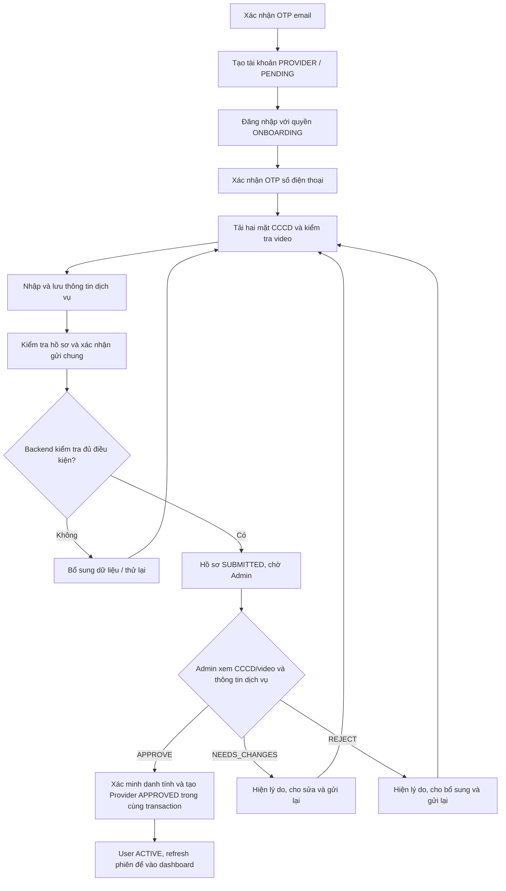

# Flow đăng ký và duyệt Provider

## 1. Luồng tổng quát

## 2. Bốn bước trên giao diện

### Bước 1 — Xác minh

1. Xác nhận số điện thoại bằng OTP.
2. Tạo hoặc tiếp tục phiên xác minh.
3. Chọn ảnh mặt trước và mặt sau CCCD. Spring lưu bằng chứng riêng tư rồi gọi DocumentAI đọc dữ liệu.
4. Kiểm tra thông tin OCR; nếu chưa đọc đủ trường bắt buộc, tải lại ảnh.
5. Quay video hoặc chọn file có sẵn. Hướng dẫn: nhìn thẳng → quay một phía → quay phía còn lại → nhìn thẳng.
6. Spring gửi ảnh CCCD đã lưu cùng video đến IdentityVerification.
7. Người dùng xác nhận dữ liệu của mình để tiếp tục điền hồ sơ.

Với Provider, thao tác xác nhận tại bước này chỉ chuẩn bị/sàng lọc dữ liệu, không tạo một lượt duyệt Admin riêng. `READY_TO_SUBMIT` chưa có nghĩa Provider đã hoạt động.

Camera MVP dùng hướng dẫn theo thời gian. Giao diện không đo góc đầu trực tiếp; Python kiểm tra động tác sau khi upload. Trạng thái đã upload chưa đủ để bật gửi hồ sơ: backend kiểm tra ngưỡng điểm và yêu cầu bằng chứng mới của Admin.

### Bước 2 — Thông tin dịch vụ

- Tên hiển thị, hotline, địa chỉ giao nhận và vị trí giao nhận.
- Chọn vị trí trên bản đồ; có lựa chọn định vị hiện tại trong bộ chọn bản đồ, hoặc mở tọa độ thủ công.
- Ngân hàng là mục tùy chọn. Nếu khai báo phải nhập đủ bộ thông tin.
- Có thể lưu hồ sơ khi chưa được Admin duyệt. Nút lưu nháp hiện vẫn yêu cầu dữ liệu hợp lệ theo DTO, không phải lưu mọi form đang bỏ trống.
- `Lưu thông tin` lưu form hợp lệ; `Lưu và tiếp tục` lưu phiên bản mới rồi chuyển sang bước kiểm tra. Không dùng tên Lưu nháp khi form còn yêu cầu đủ trường bắt buộc.

### Bước 3 — Kiểm tra hồ sơ

- Xem bản tóm tắt CCCD/video và thông tin dịch vụ.
- Chỉnh sửa nhóm thông tin cần thay đổi; lưu lại trước khi gửi.
- Xác nhận tính chính xác, bấm `Gửi hồ sơ xét duyệt` đúng một lần cho cả hồ sơ.

Backend kiểm tra OTP, thông tin dịch vụ và kết quả AI; gắn `submittedAttemptId` vào hồ sơ để Admin duyệt đúng phiên bằng chứng. Tài khoản vẫn `PENDING`, chưa tạo Provider hoạt động.

### Bước 4 — Theo dõi xét duyệt

- `SUBMITTED`: hồ sơ đang chờ; không sửa bản hồ sơ đã gửi.
- `NEEDS_CHANGES` hoặc `REJECTED`: đọc phản hồi, sửa/bổ sung và gửi lại.
- `APPROVED`: refresh session, nhận quyền phù hợp rồi vào dashboard Provider. Nếu chưa có ngân hàng nhận tiền, hoàn thiện checklist tại mục Tài chính trước khi chấp nhận đơn thuê.

## 3. Admin duyệt chung

1. Mở mục xác minh/onboarding Provider, lấy danh sách hồ sơ `SUBMITTED`.
2. Xem thông tin dịch vụ và `identityAttemptId` đi kèm.
3. Mở chi tiết CCCD, video và các chỉ số AI từ phiên đó.
4. Xác nhận đã kiểm tra bằng chứng, chọn quyết định.
5. Gửi một request review hồ sơ Provider.

Với hồ sơ mới chưa có danh tính được duyệt, `APPROVE` thực hiện trong cùng transaction:

1. Duyệt phiên CCCD/video được gắn vào hồ sơ.
2. Tạo hoặc xác nhận danh tính phù hợp và gắn vào User.
3. Tạo Provider cá nhân với trạng thái `APPROVED`.
4. Đổi User sang `ACTIVE`.
5. Lưu quyết định, người duyệt, thời gian và snapshot thông tin dịch vụ vào lịch sử.

Lỗi ở bất kỳ bước nào làm rollback transaction. Không kích hoạt Provider chỉ vì AI đã đạt điểm.

Yêu cầu bổ sung/từ chối phải có ghi chú hướng dẫn. Mỗi lượt duyệt mới lưu snapshot form và CCCD/video; Admin có thể mở lại đúng bằng chứng cũ từ lịch sử.

## 4. Bổ sung và gửi lại

| Quyết định | Cách tiếp tục |
| --- | --- |
| `NEEDS_CHANGES` | Hồ sơ được sửa. Phiên bằng chứng đi kèm được trả về `READY_TO_SUBMIT`; có thể sửa thông tin dịch vụ hoặc tải lại bằng chứng nếu cần. Gửi lại sẽ được kiểm tra policy lại. |
| `REJECT` | Hồ sơ được sửa, không cần Admin `REOPEN`. Phiên xác minh bị từ chối là phiên kết thúc; nếu chưa có danh tính được duyệt, tạo phiên mới và bổ sung CCCD/video trước khi gửi lại. |

Trường hợp tài khoản đã có danh tính được duyệt từ luồng trước, việc từ chối hồ sơ dịch vụ không tự thu hồi danh tính đó. Người dùng có thể sửa thông tin dịch vụ và gửi lại theo điều kiện hiện tại.

## 5. Liên kết tài khoản Renter có sẵn

Không gộp tài khoản đăng nhập. Tài khoản nguồn đã xác minh tạo yêu cầu liên kết đến email tài khoản đích; nguồn và đích đều phải xác nhận bằng mật khẩu của chính mình.

Nếu có đủ bằng chứng của phiên nguồn đã được duyệt, hệ thống có thể sao chép bằng chứng sang phiên Provider để dùng lại. Provider vẫn phải gửi hồ sơ tổng hợp để Admin duyệt. Nếu không tái sử dụng được bằng chứng, cần bổ sung CCCD/video.

## 6. Hồ sơ cũ và endpoint cũ

- Dữ liệu đang ở bước duyệt danh tính riêng từ luồng cũ: người dùng cần hoàn thiện và gửi hồ sơ dịch vụ để vào hàng đợi duyệt chung.
- Provider đã có danh tính được duyệt có thể dùng lại danh tính đó khi gửi hồ sơ dịch vụ.
- `POST /api/admin/identity-attempts/{id}/review` trả `410 PROVIDER_COMBINED_REVIEW_REQUIRED`; dùng API review hồ sơ Provider.
- Các API xem chi tiết và tải bằng chứng danh tính vẫn dùng trong màn hình Admin tổng hợp.
