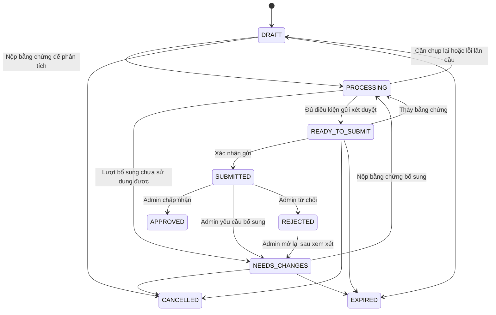

# 02. Trạng thái và bảng quyết định

## Ba lớp độc lập

1. Hồ sơ: vòng đời nộp và xét duyệt.
2. Lượt xử lý: trạng thái chạy AI, thành công hoặc lỗi; gắn với revision.
3. Kiểm tra: bằng chứng riêng như OCR, QR, đối chiếu mặt; không dùng làm trạng thái hồ sơ.

## Trạng thái hồ sơ đích

| Mã | Nhãn | Ý nghĩa |
|---|---|---|
| DRAFT | Chưa gửi | Đang chuẩn bị bằng chứng |
| PROCESSING | Đang phân tích | Một lượt xử lý đang chạy |
| READY_TO_SUBMIT | Sẵn sàng gửi | Đủ bằng chứng tối thiểu để Admin xem; không có nghĩa mọi kiểm tra đạt |
| SUBMITTED | Chờ xét duyệt | Đã xác nhận gửi, khóa revision được gửi |
| NEEDS_CHANGES | Cần bổ sung | Admin chỉ rõ phần cần thay đổi |
| APPROVED | Đã được chấp nhận | Admin chấp nhận revision cụ thể |
| REJECTED | Đã từ chối | Admin quyết định kèm lý do |
| CANCELLED | Đã hủy | Kết thúc phiên theo yêu cầu người nộp |
| EXPIRED | Phiên hồ sơ hết hạn | Phiên chuẩn bị/bổ sung hết hạn, không phải ngày hết hạn giấy tờ |

`DOCUMENT_READY` hiện có có thể giữ làm bước tiến độ trong giai đoạn chuyển đổi; đích là `processingStage`, không phải trạng thái xét duyệt bổ sung. `ERROR` hiện có cần được ánh xạ sang lỗi lượt xử lý và hồ sơ có thể thử lại; không đổi enum/DB trực tiếp trước khi kiểm tra tương thích.

## Chuyển trạng thái

PROCESSING lỗi phải quay về trạng thái chuẩn bị phù hợp với nguồn bắt đầu; giữ chi tiết lỗi/lượt chạy. Timeout phải có cơ chế thu hồi lượt chạy, không treo vô hạn. Không tự hết hạn hồ sơ SUBMITTED do Admin xử lý chậm; thời hạn bằng chứng cần kiểm tra lại khi quyết định.

APPROVED và CANCELLED không sửa tại chỗ: tạo hồ sơ thay thế khi cần. REJECTED được mở lại qua thao tác Admin có lý do và lịch sử; đây là yêu cầu triển khai mới cho renter/GPLX, không tuyên bố đã có.

## Bảng quyết định MVP

| Tình huống | Hướng xử lý | Có thể gửi Admin? |
|---|---|---|
| File sai loại, quá giới hạn, ảnh/video không đọc được | Thay file đúng yêu cầu | Chưa, vì không có bằng chứng sử dụng được |
| Ảnh mờ nhưng vẫn xem được, OCR thiếu/chưa chắc | Đề nghị chụp lại; cho kiểm tra thủ công nếu Admin vẫn xem được | Có, đánh dấu cần kiểm tra và bổ sung dữ liệu từ ảnh |
| Người dùng khai báo mẫu cũ không QR | OCR, ghi khai báo và tình trạng kiểm tra QR | Có |
| Có QR nhưng chưa giải mã được | Chụp lại hoặc kiểm tra thủ công | Có |
| Bộ đọc QR bị tắt/lỗi | Ghi NOT_RUN/ERROR đúng nguyên nhân | Có nếu chính sách cho manual fallback |
| OCR và QR mâu thuẫn | Giữ cả hai giá trị, chỉ rõ trường mâu thuẫn | Có, không tự chọn giá trị “đúng” |
| QR và OCR khớp | Ghi nhận nhất quán, không xác thực giấy tờ thật | Có, vẫn cần Admin |
| Ngày hết hạn chưa rõ hoặc có khả năng OCR sai | Admin đối chiếu ảnh | Có |
| Ngày in đọc được cho thấy đã hết hạn | Cảnh báo không đủ điều kiện sử dụng; đề nghị giấy tờ còn hạn | Có để kiểm tra sai đọc; Admin không được bỏ qua ngày hết hạn đã xác nhận |
| Video không có frame sử dụng được hoặc không đủ động tác bắt buộc | Quay lại theo hướng dẫn | Chưa, vì thiếu bằng chứng video tối thiểu |
| Video sử dụng được nhưng điểm thấp/ít frame chấm được | Nêu mức chưa đủ cơ sở, chuyển kiểm tra thủ công | Có; không dùng ngưỡng cũ để tự chặn mọi hồ sơ |
| Nghi ảnh chỉnh sửa, ảnh AI, chụp lại màn hình | FLAGGED, lưu bằng chứng và phương pháp | Có; không tự từ chối vì một signal |
| Bộ kiểm tra tương lai chưa hỗ trợ | NOT_SUPPORTED, hiển thị giới hạn | Theo chính sách; không ghi PASS |
| Dịch vụ AI timeout/busy/lỗi | Giữ bằng chứng, thử lại; manual fallback nếu đủ dữ liệu và chính sách cho phép | Không tự chuyển sang REJECTED |

Đủ bằng chứng tối thiểu: hai mặt có thể mở xem đúng loại file và video có thể xem đối với hồ sơ danh tính. Động tác/chất lượng bắt buộc là điều kiện thu thập của MVP, không phải bằng chứng chống giả mạo. Việc thay đổi điều kiện này cần phiên bản chính sách.

## Kiểm tra bắt buộc và fallback

Mỗi check khai báo: requiredFor (PROCESSING/SUBMISSION/APPROVAL), mode (ENFORCED/ADVISORY/RESEARCH), và onUnavailable (RETRY/MANUAL_REVIEW/BLOCK). Không mặc định mọi check phải PASS, cũng không mặc định check lỗi được bỏ qua. Một kiểm tra nghiên cứu không được âm thầm tham gia quyết định.

## Quyết định và đồng thời

- Chấp nhận: Admin xác nhận đã xem ảnh/video và hoàn thiện các trường bắt buộc từ bằng chứng. Trường không xác định được phải yêu cầu bổ sung.
- Bổ sung/từ chối/mở lại: bắt buộc reasonCode và ghi chú hữu ích; danh sách trường hoặc bằng chứng cần nộp lại.
- SUBMITTED khóa revision; muốn thay bằng chứng phải rút hồ sơ về chuẩn bị qua thao tác có lịch sử hoặc được yêu cầu bổ sung. Không sửa lén ảnh trong hồ sơ Admin đang xem.
- Quyết định phải kèm expectedVersion; hai Admin thao tác đồng thời chỉ một cập nhật hợp lệ. Callback AI cũ không được ghi đè revision mới.
- Submit/review/retry phải chống tạo lặp bằng idempotency hoặc khóa/phiên bản tương đương. Lịch sử append-only, không xóa quyết định cũ.
